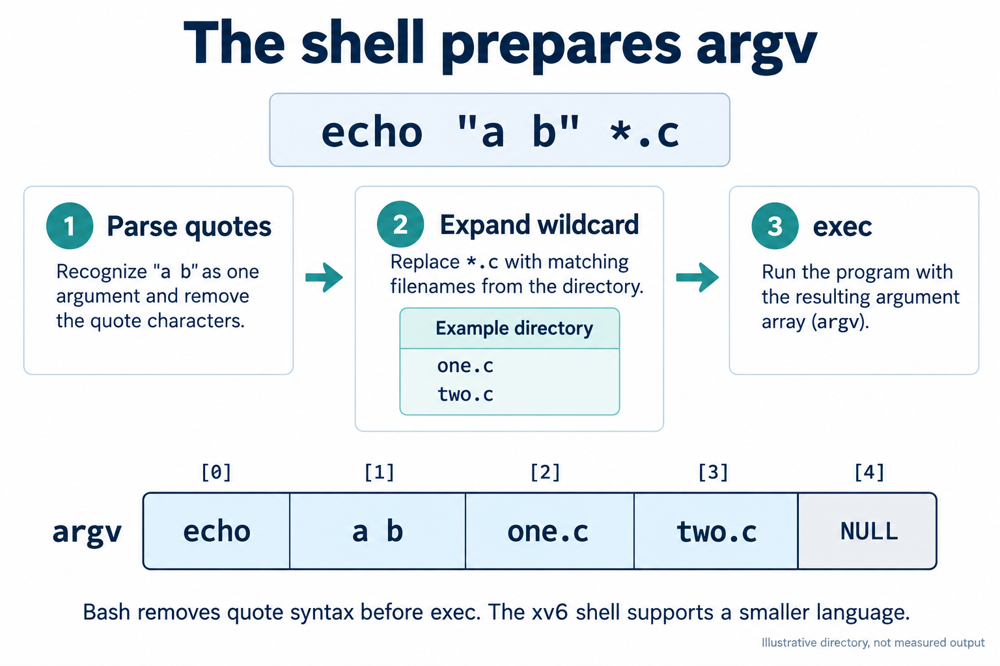

# Lab 3: From a command line to a result

Lab 3 follows one command through several layers. Bash reads the text, decides which parts are syntax, prepares arguments and file descriptors, then starts builtins or programs. The kernel supplies processes, files, pipes and scheduling. Understanding that division explains why a wildcard changes before `echo` runs, why redirection affects a program without changing its code, and why `cd` must change the shell process itself.

The brief asks you to predict the result before running marked commands. Write down the expected arguments or streams first, then compare them with the output. A mismatch is useful when you can name the step that caused it: parsing, expansion, redirection, program logic or a kernel service.

## Work in a disposable directory

Use WSL or another Linux shell. Keep experiments away from the coursework files by copying the data and scripts into a temporary directory:

```bash
lab=/mnt/d/edu/faf/sem5/os/lab3
work=$(mktemp -d)
cp "$lab/access.log" "$lab/oneliners.sh" "$lab/report.sh" "$work/"
cd "$work"
bash oneliners.sh
bash report.sh access.log
bash report.sh missing.log
```

For the quoting and glob exercises, use a separate scratch subdirectory:

```bash
mkdir play
cd play
touch a.c b.c file1.txt file2.txt notes.txt "alfa beta.txt"
echo *.c
echo '$HOME' "$HOME" \$HOME
```

The commands operate on the temporary copy or scratch directory. To test direct script execution, return to `$work`, run `chmod +x report.sh`, then run `./report.sh access.log`. The original coursework files do not need the permission change.

## Bash prepares words before a program runs

Bash does not pass the raw command line to `echo`. It first recognizes words and operators, then performs expansions. In `echo *.c`, filename expansion replaces `*.c` with matching names in the current directory. If the directory contains `a.c` and `b.c`, `echo` receives two arguments and simply prints them. The `echo` program does not search the directory or interpret the star.



The diagram shows the shell/program boundary at a high level. It is not an execution capture or a complete specification of Bash's expansion-order algorithm.

Whitespace between literal words separates arguments. Bash's `IFS` variable has a narrower role: it controls word splitting when an unquoted expansion produces text. These are different steps. In `ls alfa beta.txt`, the space separates two path arguments. The single path `alfa beta.txt` must be grouped, for example as `ls "alfa beta.txt"` or `ls alfa\ beta.txt`.

Quotes control grouping and expansion while Bash reads the command. Single quotes preserve their contents literally. Double quotes still allow variable and command substitution but keep the result in one argument. A backslash protects the next character. Bash removes the quote marks before it starts a program. Thus `echo '$HOME' "$HOME" \$HOME` receives three arguments: literal `$HOME`, the value of `HOME`, and literal `$HOME` again.

An external program receives an argument vector, often written `argv`. The shell has already decided which strings belong in it. The kernel starts the process and makes those strings available to the program; it does not expand `*.c`, remove quotes or interpret `$HOME`. For a command name without a slash, Bash searches the directories listed in `PATH`. `cd` is a builtin because a child process changing its own directory would leave the interactive shell in its previous directory.

## Descriptors explain redirection and pipes

A process conventionally starts with file descriptors 0, 1 and 2 for standard input, standard output and standard error. A descriptor is a small handle for an open file, device or pipe. A program can read from descriptor 0 and write to 1 or 2 without knowing whether they point at the terminal or a file.

For `ls /etc /nope > out.txt 2> err.txt`, Bash opens the two destinations and connects descriptor 1 to `out.txt` and descriptor 2 to `err.txt` before `ls` runs. Redirections are processed from left to right. In `ls /etc /nope > all.txt 2>&1`, descriptor 1 first points at `all.txt`, so descriptor 2 is then made to point at the same destination. In `ls /etc /nope 2>&1 > all.txt`, descriptor 2 first copies descriptor 1's terminal destination; changing descriptor 1 afterward does not move descriptor 2.

In `wc -l < access.log`, Bash connects the file to descriptor 0. `wc` receives no filename argument, so it prints only the count. With `wc -l access.log`, `wc` opens the named file itself and includes the filename in its output.

A pipe connects one process's descriptor 1 to another process's descriptor 0. Bash creates the pipe and starts the commands with those connections in place. The kernel carries bytes through a pipe buffer; Bash does not collect the whole output into a string first. Each process and the shell must close pipe ends they do not use. Otherwise a reader may never see end-of-file because some process still holds a write end open.

## Trace the supplied pipeline

Question 4 in [`oneliners.sh`](oneliners.sh) asks which users have the most failed requests. Its pipeline is:

```bash
grep FAIL access.log | cut -d' ' -f3 | sort | uniq -c | sort -rn | head -n 2
```

The supplied log uses one space between fields. `grep` keeps rows containing `FAIL`; `cut` selects field 3, the username. The first `sort` puts equal names next to one another because `uniq -c` counts adjacent runs, not every occurrence in an unsorted stream. The second `sort -rn` orders the counts from largest to smallest, and `head` keeps the leading rows. Each program reads its input from descriptor 0 and writes its output to descriptor 1, which is how the pipes connect the stages.

The saved run on the supplied 500-line dataset records `user3` and `user5` tied at 15 failed requests. A tie is a shared maximum; the order of equal rows does not establish a higher rank. The same dataset gives two useful checks from the brief: Q3 page counts sum to 500 requests, and the failure counts behind Q4 sum to 100.

This pipeline also exposes an assumption. `cut -d' ' -f3` works because the generated records have exactly one space between fields. If the input used variable runs of whitespace, field 3 could be empty or wrong; the parser would need to handle whitespace runs rather than a single literal delimiter.

[`report.sh`](report.sh) shows the same boundaries in a script. It reads the path from `$1`, tests whether that path names a regular file, writes a missing-file diagnostic to descriptor 2, and exits with status 1 on failure. On success, command substitutions capture the counts printed by `wc` and `grep`, then the loop prints failure counts for `user0` through `user6`. The shell interprets the variables, test, substitutions and loop. The external `wc` and `grep` programs do the counting.

`bash report.sh access.log` asks Bash to read the script, so the executable bit is unnecessary. `./report.sh access.log` asks the system to execute it directly: the file must be executable, and `#!/bin/bash` names its interpreter. The `./` matters because a command name without a slash is searched for in `PATH`, which usually does not include the current directory. A command that Bash cannot find returns status 127; the script deliberately returns status 1 for its own missing-file case.

## Processes and command structure

The operators `;`, `&&` and `||` connect commands in different ways. A semicolon runs the next command regardless of the previous status. `&&` runs the next command only after success. `||` runs it only after failure. Bash exposes the most recent status as `$?`.

For an external command, a shell commonly forks a child and uses `exec` in that child to replace its program image. `wait` lets the parent collect a child's completion. A builtin such as `cd` runs in the shell process itself. The kernel supplies process isolation, file access, descriptors, pipes and scheduling; Bash chooses the command words and connections before requesting those services.

## A short speaking route

Start with the question, “Which layer changed the command?” Use `echo *.c` to show that Bash expands the pattern before `echo` receives `argv`. Then explain one redirection by naming the descriptor that changes, and trace Q4 from matching failed rows to grouped usernames and a tied maximum. Finish by contrasting a script run through Bash with direct execution, including the shebang and executable bit. This route connects the lab's shell behavior to the process and file services supplied by the kernel.

## Practice prompts

Try these before reading the checking notes below.

1. In the scratch directory, predict the arguments to `echo *.c` and `echo "$HOME" *.c`. Which part can produce several arguments?
2. Explain the difference between `wc -l < access.log` and `wc -l access.log` using `argv` and descriptor 0.
3. For both redirection orders in the brief, state where descriptor 2 points after the shell processes each operator.
4. Remove the first `sort` from the Q4 pipeline. Explain what `uniq -c` counts now and why the result can be wrong.
5. Why can `bash report.sh missing.log` run without `chmod +x`, while `./report.sh missing.log` needs it? What does the script's `exit 1` distinguish from Bash's status 127?
6. If a future `access.log` uses several spaces between fields, which assumption in Q4 fails?
7. Why must `cd` change the interactive shell process, and what does the kernel do when Bash launches an external command?

## Checking notes

1. `*.c` can expand to one argument per matching filename. In `echo "$HOME" *.c`, the quoted variable value stays one argument, while the unquoted glob can expand to several.
2. With input redirection, the shell connects the file to descriptor 0 and gives `wc` no filename argument. With a filename argument, `wc` opens that path and prints its name with the count.
3. In `> all.txt 2>&1`, descriptor 1 moves to the file first, then descriptor 2 copies that destination. In `2>&1 > all.txt`, descriptor 2 copies the old destination, usually the terminal, before descriptor 1 changes.
4. `uniq -c` counts adjacent runs. Without sorting by username first, repeated users can be split into several runs and undercounted.
5. `bash` reads the file as input and interprets it. Direct execution uses the executable permission and the shebang to select Bash. Status 1 is the script's explicit missing-file result; status 127 is Bash's command-not-found status.
6. The literal-space delimiter no longer identifies fields reliably. A parser that treats one or more whitespace characters as a separator would be needed.
7. `chdir` changes only the calling process's working directory. If a child implemented `cd`, the parent shell would remain where it was. For external commands, Bash prepares the argument strings and descriptors; the kernel creates or replaces the process and supplies the requested services.

## Source and observation note

The task details are in [`L3_SO.pdf`](L3_SO.pdf), and the worked commands are in [`oneliners.sh`](oneliners.sh) and [`report.sh`](report.sh). The saved `access.log` measurements are specific to the supplied dataset. `PATH`, `/etc/passwd`, Bash options and unmatched-glob behavior can vary by system.
