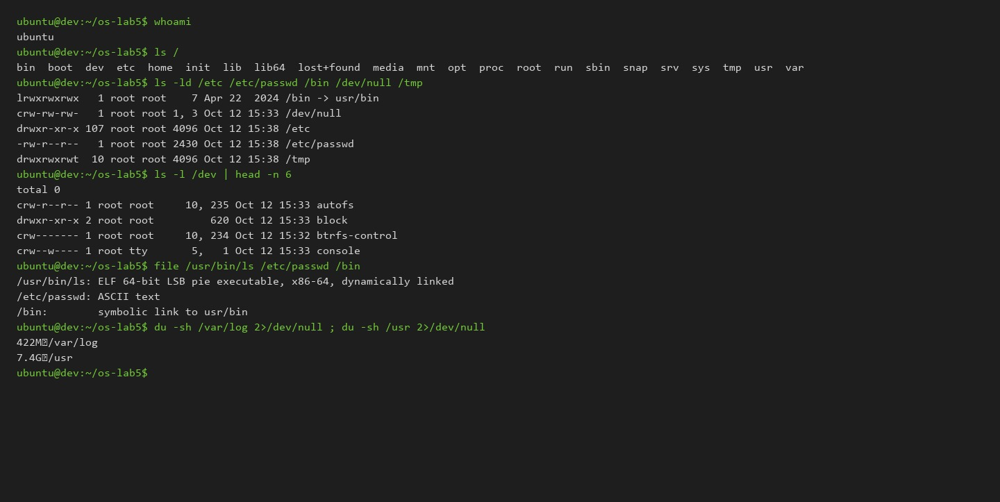
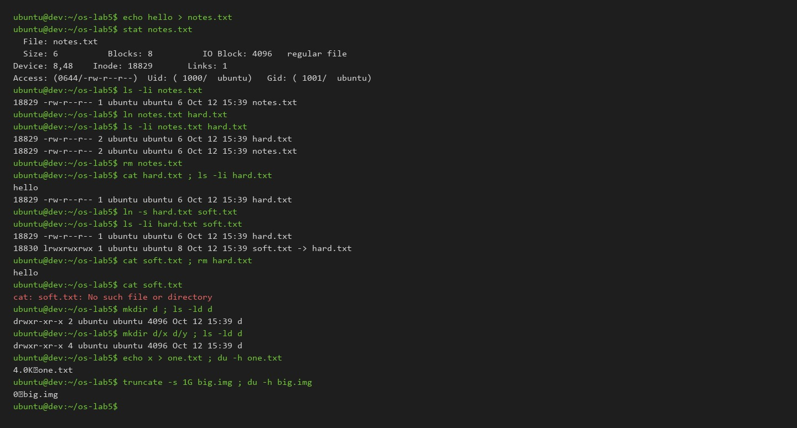
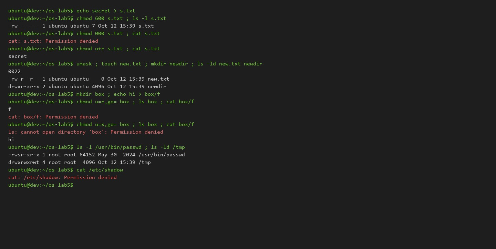
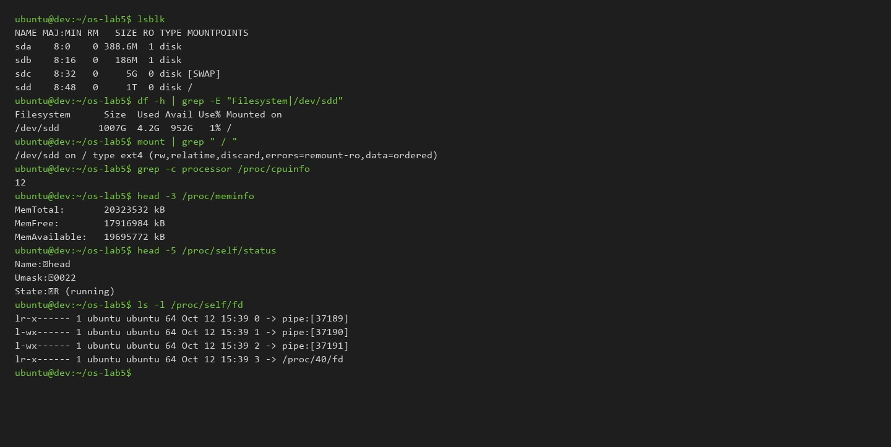
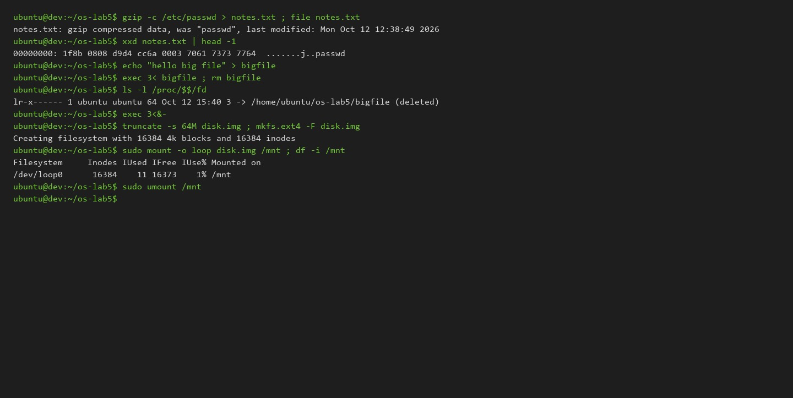

# Operating Systems Lab 5: The File System with Your Own Hands

**Track:** A (Warm-up on Linux)  
**Author:** Lucian-Adrian Gavril (FAF-241)  
**Environment:** Ubuntu 24.04 LTS (WSL2, Linux kernel 6.6.87.2-microsoft-standard-WSL2, x86_64)  
**User:** `ubuntu` (UID 1000, non-root)  
**Date:** 2026-10-12  

---

## Executive Summary

This laboratory explores the Linux VFS (Virtual Filesystem) abstraction directly through system utilities, file descriptor inspections, and disk analysis. All experiments were conducted as unprivileged user `ubuntu` (UID 1000) inside `~/os-lab5` to ensure DAC (Discretionary Access Control) permission evaluations reflect authentic user space execution. Every command, observed terminal output, and architectural analysis is documented below, including all four optional stretch exercises.

---

## Part 1. The Tree and the File Types

### Terminal Commands and Outputs

```bash
$ whoami
ubuntu

$ ls /
bin  boot  dev  etc  home  init  lib  lib64  lost+found  media  mnt  opt  proc  root  run  sbin  snap  srv  sys  tmp  usr  var

$ ls -ld /etc /etc/passwd /bin /dev/null /tmp
lrwxrwxrwx   1 root root    7 Apr 22  2024 /bin -> usr/bin
crw-rw-rw-   1 root root 1, 3 Oct 12 15:33 /dev/null
drwxr-xr-x 107 root root 4096 Oct 12 15:38 /etc
-rw-r--r--   1 root root 2430 Oct 12 15:38 /etc/passwd
drwxrwxrwt  10 root root 4096 Oct 12 15:38 /tmp

$ ls -l /dev | head -n 10
total 0
crw-r--r-- 1 root root     10, 235 Oct 12 15:33 autofs
drwxr-xr-x 2 root root         620 Oct 12 15:33 block
drwxr-xr-x 2 root root         140 Oct 12 15:32 bsg
crw------- 1 root root     10, 234 Oct 12 15:32 btrfs-control
drwxr-xr-x 2 root root        2900 Oct 12 15:33 char
crw--w---- 1 root tty       5,   1 Oct 12 15:33 console
lrwxrwxrwx 1 root root          11 Oct 12 15:32 core -> /proc/kcore
crw------- 1 root root     10, 123 Oct 12 15:33 cpu_dma_latency
crw------- 1 root root     10, 203 Oct 12 15:32 cuse

$ file /usr/bin/ls /etc/passwd /bin
/usr/bin/ls: ELF 64-bit LSB pie executable, x86-64, version 1 (SYSV), dynamically linked, interpreter /lib64/ld-linux-x86-64.so.2, BuildID[sha1]=05dad2c279f7651722809fa75adba6bf9ab1c209, for GNU/Linux 3.2.0, stripped
/etc/passwd: ASCII text
/bin:        symbolic link to usr/bin

$ du -sh /var/log 2>/dev/null ; du -sh /usr 2>/dev/null
422M	/var/log
7.4G	/usr
```



### Observe 1: Analysis & Answers

1. **Path Types from the First Letter of `ls -ld`:**
   - `/bin`: `l` (Symbolic link). Points to `usr/bin`.
   - `/dev/null`: `c` (Character device). Streams character-by-character without caching blocks.
   - `/etc`: `d` (Directory). Contains system configuration tables.
   - `/etc/passwd`: `-` (Regular file). Contains plain text user accounts.
   - `/tmp`: `d` (Directory). Temporary shared directory with mode `1777` (trailing sticky bit `t`).

2. **`/bin` Architecture:**
   On this Ubuntu 24.04 LTS host, `/bin` is a symbolic link pointing to `usr/bin`. This follows the standard Linux UsrMerge architecture, unifying legacy root binaries with `/usr/bin` to eliminate package path duplication.

3. **Devices in `/dev`:**
   - **Character device:** `/dev/null` (Major device 1, Minor device 3). Also `/dev/console` (5, 1).
   - **Block device:** `/dev/sda` (Major device 8, Minor device 0) and `/dev/sdd` (8, 48), supporting random block access with kernel buffer cache support.

4. **Storage Comparison (`/var/log` vs `/usr`):**
   - `/var/log` occupies `422M`.
   - `/usr` occupies `7.4G`.
   - `/usr` is roughly 7.0 GB larger (~17.5 times the size of `/var/log`). This is expected because `/usr` contains user-space binaries, shared C/C++ libraries, toolchains, header files, and system assets, whereas `/var/log` only stores runtime operational logs.

---

## Part 2. Inodes and Links

### Terminal Commands and Outputs

```bash
$ cd ~/os-lab5

# 1. An inode and a name that is not part of it
$ echo hello > notes.txt
$ stat notes.txt
  File: notes.txt
  Size: 6         	Blocks: 8          IO Block: 4096   regular file
Device: 8,48	Inode: 18829       Links: 1
Access: (0644/-rw-r--r--)  Uid: ( 1000/  ubuntu)   Gid: ( 1001/  ubuntu)
Access: 2026-10-12 15:39:25.365783893 +0300
Modify: 2026-10-12 15:39:25.365783893 +0300
Change: 2026-10-12 15:39:25.365783893 +0300
 Birth: 2026-10-12 15:39:25.365783893 +0300

$ ls -li notes.txt
18829 -rw-r--r-- 1 ubuntu ubuntu 6 Oct 12 15:39 notes.txt

# 2. Hard link, then remove original
$ ln notes.txt hard.txt
$ ls -li notes.txt hard.txt
18829 -rw-r--r-- 2 ubuntu ubuntu 6 Oct 12 15:39 hard.txt
18829 -rw-r--r-- 2 ubuntu ubuntu 6 Oct 12 15:39 notes.txt
$ rm notes.txt
$ cat hard.txt ; ls -li hard.txt
hello
18829 -rw-r--r-- 1 ubuntu ubuntu 6 Oct 12 15:39 hard.txt

# 3. Symbolic link, then remove target
$ ln -s hard.txt soft.txt
$ ls -li hard.txt soft.txt
18829 -rw-r--r-- 1 ubuntu ubuntu 6 Oct 12 15:39 hard.txt
18830 lrwxrwxrwx 1 ubuntu ubuntu 8 Oct 12 15:39 soft.txt -> hard.txt
$ cat soft.txt
hello
$ rm hard.txt
$ cat soft.txt
cat: soft.txt: No such file or directory
$ ls -l soft.txt
lrwxrwxrwx 1 ubuntu ubuntu 8 Oct 12 15:39 soft.txt -> hard.txt

# 4. Directory link counts
$ mkdir d ; ls -ld d
drwxr-xr-x 2 ubuntu ubuntu 4096 Oct 12 15:39 d
$ mkdir d/x d/y ; ls -ld d
drwxr-xr-x 4 ubuntu ubuntu 4096 Oct 12 15:39 d

# 5. Logical size vs disk allocation
$ echo x > one.txt ; ls -l one.txt ; du -h one.txt
-rw-r--r-- 1 ubuntu ubuntu 2 Oct 12 15:39 one.txt
4.0K	one.txt

$ truncate -s 1G big.img ; ls -lh big.img ; du -h big.img
-rw-r--r-- 1 ubuntu ubuntu 1.0G Oct 12 15:39 big.img
0	big.img
$ rm big.img
```



### Observe 2: Analysis & Answers

1. **Inode and Link Count in `stat`:**
   - The inode number is printed under `Inode:` (`18829`).
   - The link count is printed under `Links:` (`Links: 1`, then `Links: 2`).

2. **Survival of `hard.txt` and What `rm` Deletes:**
   A directory entry is merely a tuple mapping a human-readable name to an inode number. Both `notes.txt` and `hard.txt` pointed directly to inode 18829. When `rm notes.txt` was executed, the kernel invoked `unlink()`. This system call unlinks the directory entry `notes.txt` from the parent directory and decrements the inode's link counter (`i_nlink`) from 2 to 1. Because `i_nlink` remained non-zero, the inode and its data blocks were never freed. `hard.txt` still addresses inode 18829, allowing `cat hard.txt` to read the data without interruption.

3. **Symlink Failure and Exact Size:**
   - `cat soft.txt` failed with `No such file or directory` because a symbolic link does not point to an inode; it stores the target pathname string (`"hard.txt"`). When `hard.txt` was unlinked, the symlink became dangling. The `open()` call follows the path to `hard.txt`, fails to locate any matching directory entry, and returns `ENOENT`.
   - The size of `soft.txt` is exactly `8` bytes. The file system stores the target string `"hard.txt"` verbatim in the symlink inode (or fast inline data buffer), which comprises exactly 8 ASCII characters.

4. **Directory Link Count Mathematics:**
   - When directory `d` is newly created, its link count is `2`:
     1. The entry `d` in the parent directory (`~/os-lab5`).
     2. The self-referencing entry `.` inside `d` (`d/.`).
   - When subdirectories `d/x` and `d/y` are created, `d`'s link count increments to `4`:
     3. The parent-referencing entry `..` inside `d/x` (`d/x/..` -> `d`).
     4. The parent-referencing entry `..` inside `d/y` (`d/y/..` -> `d`).
   Every child directory's `..` pointer adds a hard link back to its parent.

5. **Physical Allocation: 2 Bytes vs 1 GB:**
   - File systems allocate storage in discrete filesystem blocks (here 4096 bytes / 4 KiB in ext4). Even though `one.txt` contains only 2 bytes (`'x'` and `'\n'`), the kernel allocates an entire 4 KiB physical block.
   - `truncate -s 1G big.img` generates a sparse file. It sets the logical file size field (`i_size`) in the inode metadata to $1073741824$ bytes without committing any physical data blocks to disk. Because zero extents are allocated in the filesystem block map, `du -h` truthfully reports `0`.

---

## Part 3. Permissions

### Terminal Commands and Outputs

```bash
# 6. Files
$ echo secret > s.txt
$ chmod 600 s.txt ; ls -l s.txt
-rw------- 1 ubuntu ubuntu 7 Oct 12 15:39 s.txt

$ chmod 000 s.txt ; cat s.txt
cat: s.txt: Permission denied

$ chmod u+r s.txt ; cat s.txt
secret

$ umask ; touch new.txt ; mkdir newdir ; ls -ld new.txt newdir
0022
-rw-r--r-- 1 ubuntu ubuntu    0 Oct 12 15:39 new.txt
drwxr-xr-x 2 ubuntu ubuntu 4096 Oct 12 15:39 newdir

# 7. Directories
$ mkdir box ; echo hi > box/f

# Read-only directory
$ chmod u=r,go= box ; ls box ; cat box/f
f
cat: box/f: Permission denied

# Execute-only directory
$ chmod u=x,go= box ; ls box ; cat box/f
ls: cannot open directory 'box': Permission denied
hi

$ chmod 755 box

# 8. Special bits and system files
$ ls -l /usr/bin/passwd ; ls -ld /tmp
-rwsr-xr-x 1 root root 64152 May 30  2024 /usr/bin/passwd
drwxrwxrwt 4 root root  4096 Oct 12 15:39 /tmp

$ cat /etc/shadow
cat: /etc/shadow: Permission denied

$ ls -l /etc/shadow
-rw-r----- 1 root shadow 1205 Oct 12 15:38 /etc/shadow
```



### Observe 3: Analysis & Answers

1. **Octal Permission Representation & Real Uses:**
   - `600` = `rw-------`: Read and write for owner; no access for group or others. Real use: Private SSH keys (`~/.ssh/id_rsa`, `~/.ssh/id_ed25519`) or database secret files.
   - `644` = `rw-r--r--`: Read and write for owner; read-only for group and others. Real use: Public web files, configuration files (`/etc/passwd`), documentation.
   - `755` = `rwxr-xr-x`: Read, write, execute for owner; read and execute for group and others. Real use: System executables (`/bin/ls`) and public directory paths.
   - `700` = `rwx------`: Full access for owner; zero access for all other users. Real use: User private directories like `~/.ssh` or `/root`.

2. **Why Ownership Does Not Override `chmod 000`:**
   Linux DAC evaluates permission bits using a strict sequential check:
   If `current_euid == inode->i_uid`, the kernel evaluates ONLY the owner bit triplet (`---`). Because the owner read bit is unset, permission is denied immediately. Ownership does not grant an automatic access bypass; ownership grants metadata control, specifically the authority to invoke `chmod()` and restore permissions.

3. **The `umask` Mechanism:**
   The observed umask is `0022` (octal).
   - Default base mode for creating regular files is `0666` (`rw-rw-rw-`). Masking with `0666 & ~0022` yields `0644` (`-rw-r--r--`), matching `new.txt`.
   - Default base mode for creating directories is `0777` (`rwxrwxrwx`). Masking with `0777 & ~0022` yields `0755` (`drwxr-xr-x`), matching `newdir`.

4. **Directory Read (`r`) vs Execute (`x`):**
   - **`r` (read) permission on a directory** allows reading the directory table entries (`opendir()` / `readdir()`). Therefore, `ls box` successfully enumerated the name `f`. However, `r` does NOT grant permission to traverse the directory or resolve the path down to the file's inode. Opening `box/f` failed with `Permission denied`.
   - **`x` (execute) permission on a directory** grants traversal and inode resolution rights (`search`). With `u=x`, directory enumeration is forbidden (`ls box` fails), but accessing a known filename inside (`cat box/f`) allows path resolution down to `f`'s inode, opening the file and reading `hi`.

5. **Special Bits (`s` and `t`):**
   - **`s` in `/usr/bin/passwd`:** Set-User-ID (setuid, mode `4755`). When executed, the process runs with the effective privileges of the binary's owner (`root`), rather than the invoking user.
   - **Why `passwd` needs setuid:** Password authentication data resides in `/etc/shadow`, which has permissions `-rw-r----- 1 root shadow`. Normal users cannot write to `/etc/shadow`. The setuid bit allows `passwd` to run as root, verify the existing password, and write the new hash to `/etc/shadow`.
   - **`t` in `/tmp`:** Sticky bit (mode `1777`). In a world-writable directory where everyone can create files, the sticky bit restricts deletion and renaming: only the owner of a file (or root) can delete or rename their own files.

---

## Part 4. Disks and the Kernel as Files

### Terminal Commands and Outputs

```bash
$ lsblk
NAME MAJ:MIN RM   SIZE RO TYPE MOUNTPOINTS
sda    8:0    0 388.6M  1 disk 
sdb    8:16   0   186M  1 disk 
sdc    8:32   0     5G  0 disk [SWAP]
sdd    8:48   0     1T  0 disk /mnt/wslg/distro
                               /
sde    8:64   0     1T  0 disk 

$ df -h
Filesystem      Size  Used Avail Use% Mounted on
none            9.7G     0  9.7G   0% /usr/lib/modules/6.6.87.2-microsoft-standard-WSL2
none            9.7G  4.0K  9.7G   1% /mnt/wsl
drivers         204G  185G   20G  91% /usr/lib/wsl/drivers
/dev/sdd       1007G  4.2G  952G   1% /
none            9.7G   80K  9.7G   1% /mnt/wslg
none            9.7G     0  9.7G   0% /usr/lib/wsl/lib
rootfs          9.7G  2.7M  9.7G   1% /init
none            9.7G     0  9.7G   0% /run
none            9.7G     0  9.7G   0% /run/lock
none            9.7G     0  9.7G   0% /run/shm
none            9.7G     0  9.7G   0% /run/user
none            9.7G   76K  9.7G   1% /mnt/wslg/versions.txt
none            9.7G   76K  9.7G   1% /mnt/wslg/doc
C:\             204G  185G   20G  91% /mnt/c
D:\             271G  239G   33G  89% /mnt/d

$ mount | grep " / "
/dev/sdd on / type ext4 (rw,relatime,discard,errors=remount-ro,data=ordered)

$ grep -c processor /proc/cpuinfo
12

$ head -3 /proc/meminfo
MemTotal:       20323532 kB
MemFree:        17916984 kB
MemAvailable:   19695772 kB

$ head -5 /proc/self/status
Name:	head
Umask:	0022
State:	R (running)
Tgid:	47
Ngid:	0

$ ls -l /proc/self/fd
total 0
lr-x------ 1 ubuntu ubuntu 64 Oct 12 15:39 0 -> pipe:[37189]
l-wx------ 1 ubuntu ubuntu 64 Oct 12 15:39 1 -> pipe:[37190]
l-wx------ 1 ubuntu ubuntu 64 Oct 12 15:39 2 -> pipe:[37191]
lr-x------ 1 ubuntu ubuntu 64 Oct 12 15:39 3 -> /proc/40/fd
```



### Observe 4: Analysis & Answers

1. **Disk and Filesystem Architecture:**
   - **Virtual Disk:** `/dev/sdd` (Virtual SCSI block device, capacity 1 TB, major/minor 8:48).
   - **Root Mount:** `/dev/sdd` is mounted directly at `/` (and `/mnt/wslg/distro`).
   - **Filesystem Type:** `ext4` with mount parameters `rw,relatime,discard,errors=remount-ro,data=ordered`.
   - **Swap Disk:** `/dev/sdc` (5 GB, 8:32) is configured as active swap space.

```
+-------------------------------------------------------------------+
| Host Virtual Disks (Hyper-V / WSL2 SCSI bus)                      |
|                                                                   |
|  /dev/sdd (1 TB) ----------> ext4 filesystem mounted at /         |
|  /dev/sdc (5 GB) ----------> Linux SWAP space                     |
|  /dev/sda, /dev/sdb -------> System initrd / kernel assets (RO)   |
|  Windows C:\, D:\ ---------> 9p/drvfs mounted at /mnt/c, /mnt/d   |
+-------------------------------------------------------------------+
```

2. **Root Filesystem Utilization:**
   - Total capacity: `1007G`.
   - Allocated space: `4.2G`.
   - Available free space: `952G`.
   - Utilization: `1%`.

3. **Processor Cores & System Memory:**
   - **CPU Cores:** 12 logical processors (`grep -c processor /proc/cpuinfo` returns `12`).
   - **RAM:** Total memory is `20,323,532 kB` (~19.38 GiB / 20.8 GB), with `19,695,772 kB` (~18.78 GiB) available for user applications.

4. **Program Identity in `/proc/self/status`:**
   - The reported program name is `head` (`Name: head`).
   - In Linux, `/proc/self` is a dynamic symbolic link maintained by the kernel that automatically evaluates to `/proc/<PID>` of the process executing the system call. When `head -5 /proc/self/status` runs, the process making the `open()` call is `head` itself. The kernel therefore exports the process descriptor table of `head`.

---

## Stretch Exercises (All Four Completed)



### (a) Magic Numbers & Binary Header Detection

```bash
$ gzip -c /etc/passwd > notes.txt
$ file notes.txt
notes.txt: gzip compressed data, was "passwd", last modified: Mon Oct 12 12:38:49 2026, from Unix, original size modulo 2^32 2430

$ xxd notes.txt | head -1
00000000: 1f8b 0808 d9d4 cc6a 0003 7061 7373 7764  .......j..passwd
```

- **Analysis:** The `file` utility ignores the filename extension and inspects the magic bytes at offset 0. The first two bytes, `0x1f 0x8b`, define the universal gzip magic number per RFC 1952. The third byte (`0x08`) specifies the DEFLATE compression method.

### (b) Hunt for Setuid Programs

```bash
$ find / -xdev -perm -4000 -type f 2>/dev/null
/usr/bin/su
/usr/bin/passwd
/usr/bin/mount
/usr/bin/fusermount3
/usr/bin/chsh
/usr/bin/newgrp
/usr/bin/gpasswd
/usr/bin/sudo
/usr/bin/chfn
/usr/bin/umount
/usr/lib/landscape/apt-update
/usr/lib/dbus-1.0/dbus-daemon-launch-helper
/usr/lib/openssh/ssh-keysign
/usr/lib/polkit-1/polkit-agent-helper-1
```

- **Analysis:** Standard setuid utilities include `passwd`, `su`, `sudo`, `mount`, and `umount`. Beyond the baseline lecture examples, modern Ubuntu installations include privilege escalation helpers such as `/usr/lib/polkit-1/polkit-agent-helper-1` (PolicyKit authentication agent), `/usr/lib/openssh/ssh-keysign` (hostbased SSH authentication), and `/usr/lib/dbus-1.0/dbus-daemon-launch-helper` (system bus activation).

### (c) Deleting an Open File Descriptor

```bash
$ echo "hello big file" > bigfile
$ exec 3< bigfile
$ rm bigfile
$ ls -l /proc/$$/fd
total 0
lr-x------ 1 ubuntu ubuntu 64 Oct 12 15:40 0 -> pipe:[22422]
l-wx------ 1 ubuntu ubuntu 64 Oct 12 15:40 1 -> pipe:[22423]
l-wx------ 1 ubuntu ubuntu 64 Oct 12 15:40 2 -> pipe:[22424]
lr-x------ 1 ubuntu ubuntu 64 Oct 12 15:40 3 -> /home/ubuntu/os-lab5/bigfile (deleted)

$ exec 3<&-
$ ls -l /proc/$$/fd
total 0
lr-x------ 1 ubuntu ubuntu 64 Oct 12 15:40 0 -> pipe:[22422]
l-wx------ 1 ubuntu ubuntu 64 Oct 12 15:40 1 -> pipe:[22423]
l-wx------ 1 ubuntu ubuntu 64 Oct 12 15:40 2 -> pipe:[22424]
lr-x------ 1 ubuntu ubuntu 64 Oct 12 15:40 3 -> /proc/63/fd
```

- **Analysis:** The link target in `/proc/$$/fd/3` explicitly shows `/home/ubuntu/os-lab5/bigfile (deleted)`. When `rm` is executed, the directory link is removed, but the underlying inode and data blocks remain allocated on disk because the active shell process holds an open file descriptor referencing the inode (`i_count > 0`). The space is deallocated by the kernel only when descriptor 3 is closed via `exec 3<&-`, dropping the open reference counter to zero.

### (d) Loopback Filesystem & Inode Creation

```bash
$ truncate -s 64M disk.img
$ mkfs.ext4 -F disk.img
mke2fs 1.47.0 (5-Feb-2023)
Discarding device blocks:     0/16384                                 done                            
Creating filesystem with 16384 4k blocks and 16384 inodes

Allocating group tables: 0/1         done                            
Writing inode tables: 0/1         done                            
Creating journal (1024 blocks): done
Writing superblocks and filesystem accounting information: 0/1         done

$ sudo mount -o loop disk.img /mnt
$ df -h /mnt ; df -i /mnt
Filesystem      Size  Used Avail Use% Mounted on
/dev/loop0       56M   24K   52M   1% /mnt
Filesystem     Inodes IUsed IFree IUse% Mounted on
/dev/loop0      16384    11 16373    1% /mnt

$ sudo umount /mnt
$ rm disk.img
```

- **Analysis:** `mkfs.ext4` created exactly **16,384 inodes** on the 64 MiB disk image. The superblock reserves 1 inode per 4 KiB block ratio (`16384` 4k blocks = `16384` inodes). Upon mounting, 11 inodes were already in use for filesystem bookkeeping (root directory, lost+found, journal, bad block table).

---

## Conclusion

This laboratory verified the structural boundary between human-facing filenames and kernel-managed filesystem metadata. Filenames are mere entries in directory tables pointing to inodes; unlinking a filename leaves data blocks untouched whenever hard links or open file descriptors persist. Sparse files reveal the separation between logical address space and physical disk extent allocation. Finally, directory permission semantics enforce that enumeration requires read access while traversal requires execution privileges.
