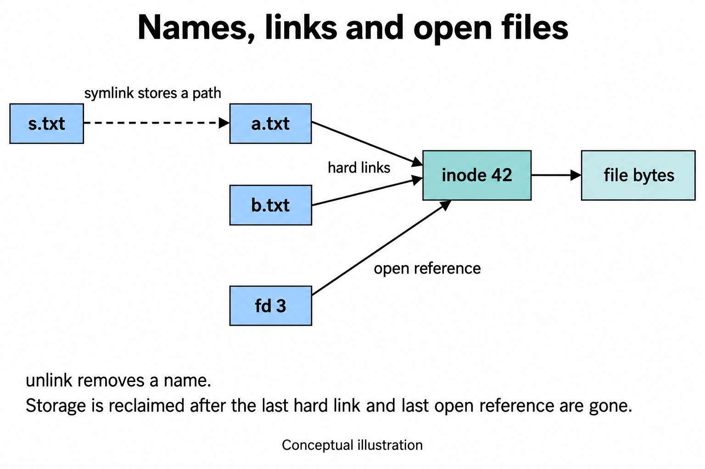

# Lab 5: names, inodes and open files

Why can a file remain readable after its name has been removed? Answering that question connects most of this lab: paths, inodes, links, descriptors, storage allocation and access permissions. A filename helps a person find an object; an inode describes the object; an open descriptor lets a process keep using it. Each belongs to a different part of the mechanism.

The coursework examines the filesystem tree and file types, hard and symbolic links, logical size and allocation, permissions, and live information under `/proc`. The stretch examples extend those ideas to content signatures, setuid files and an ext4 image. The aim is to explain why the commands behave as they do and identify the conditions that could change their results.

## How a path reaches an object

A **filesystem** organizes persistent data and metadata. A **mount** attaches a filesystem to a directory in the visible tree. `/` is the root of that tree. `/dev` and `/proc` also contain filesystem entries, but reading them can reach a device or kernel-generated information rather than ordinary disk data.

A **path** is a sequence of directory names ending at an object. A relative path starts at the process's current directory; an absolute path starts at `/`. A directory maps names to inode numbers. An inode number identifies an object within one filesystem, so the same number on another filesystem need not identify the same object.

The inode holds metadata such as type, permissions, size and link count, plus information needed to find the object's data. The filename is in the directory entry. A **hard link** is another directory entry for the same inode. A **symbolic link** is a separate object containing a pathname to resolve.

A **process** is a running program with its own current directory and open-file table. A **descriptor** is an integer selecting an entry in that table. The shell normally inherits 0 for input, 1 for output and 2 for errors. Opening a file obtains another descriptor. The kernel checks paths and permissions while handling system calls.

These relationships give two ways to reach an object:

```text
Directory entry:  name -> inode -> file data
Open process:    descriptor -> open file description -> inode -> file data



The diagram omits the open-file-table layer, so it does not trace descriptor sharing.
```

A directory entry provides a route for a future lookup. An open file description holds the state of an existing open operation, including its current offset. Once a process has opened a file, later reads use its descriptor; they do not need to resolve the original pathname again. Removing that pathname can therefore prevent a new open while leaving an existing open usable.

The descriptor number is local to the process. Descriptor 3 in another process need not refer to the same file. Conversely, duplicating a descriptor can create another reference to the same open file description, sharing its offset, as described in [dup(2)](https://man7.org/linux/man-pages/man2/dup.2.html). Two independent opens of the same inode ordinarily have separate offsets. This is why a name, an inode and a descriptor cannot be used as interchangeable identifiers.

## Trace the actual link experiment

Part 2 of [report.md](report.md) runs `echo hello > notes.txt`, `ln notes.txt hard.txt`, then removes each name. Follow the names and inode through this smaller version. Run it in Bash on Linux or WSL; the new directory is on the Linux filesystem under `/tmp`, so Windows-mounted permission behavior does not enter the example.

```bash
lab_work=$(mktemp -d /tmp/os-lab5-study.XXXXXX)
cd "$lab_work"
printf 'hello\n' > notes.txt
ln notes.txt hard.txt
ln -s hard.txt soft.txt
ls -li notes.txt hard.txt soft.txt
rm notes.txt
cat hard.txt
rm hard.txt
ls -l soft.txt
cat soft.txt
```

The final `cat` is expected to fail. In order:

1. Bash handles `>` by opening `notes.txt` for output and connecting the command's output to it. `printf` writes six bytes: five letters and a newline.
2. `ln` requests a second name for the same inode. `notes.txt` and `hard.txt` therefore have equal inode numbers and a link count of 2. Exact inode numbers depend on the filesystem state.
3. `ln -s` creates a different inode whose content is the eight-character path `hard.txt`. The path is relative to the directory containing the symlink.
4. Removing `notes.txt` removes one name and reduces the shared inode's link count to 1. `hard.txt` still reaches the data.
5. Removing `hard.txt` removes the remaining hard link. `soft.txt` still exists, but following its stored pathname fails because that name has gone.

`ls -l soft.txt` inspects the link itself; `cat soft.txt` follows its target. The distinction explains how the link can remain visible while opening it fails. If a new `hard.txt` is later created at that location, the same symlink resolves to the new object. A hard link instead keeps referring to its shared inode while that link exists.

## Trace an open file through unlink

Stretch exercise (c) uses the shell's `exec 3< bigfile`. Here `exec` has no program argument: it changes descriptors in the current shell rather than replacing its program.

```bash
# Continue in the generated study directory.
printf 'still readable\n' > opened.txt
exec 3< opened.txt
rm opened.txt
ls -l /proc/$$/fd/3
cat <&3
exec 3<&-
```

Trace the state, rather than memorizing the command:

| Step | Directory name | Shell descriptor 3 | Consequence |
| --- | --- | --- | --- |
| Create | Exists | Closed | A pathname reaches the file. |
| Open | Exists | Refers to the open file | The shell holds a reference. |
| Remove | Gone | Still open | The existing descriptor can still read. |
| Close | Gone | Closed | Storage can be reclaimed when the final reference is gone. |

`$$` expands to the shell's process ID. `<&3` duplicates its descriptor 3 onto `cat`'s standard input. Removing a final name does not invalidate an already-open descriptor. Linux documents this lifetime in [unlink(2)](https://man7.org/linux/man-pages/man2/unlink.2.html). Do not equate the inode's hard-link count with its in-memory references.

The `cat` operation advances the shared open file offset. Running `cat <&3` a second time normally reaches the end immediately, although the object still exists through descriptor 3. End of file means the current offset has reached the logical end, not that unlink destroyed the data. Closing descriptor 3 removes that open reference; another process's still-open reference could continue to keep the object alive.

## Size is not allocation

Part 2 compares `ls -l` with `du`. A file's logical length says where its end is. Allocated blocks say how much storage backs its contents. A small file may use a whole allocation block; a sparse file can contain a large unwritten region represented as a hole.

```bash
printf 'x\n' > one.txt
truncate -s 16M sparse.img
stat -c '%n: size=%s bytes, blocks=%b, block-unit=%B bytes' one.txt sparse.img
du -h one.txt sparse.img
```

Reads from the unwritten sparse region return zeros. `truncate` changes the logical size; it need not write 16 MiB of zeros. Allocation and `du` output vary by filesystem. The report's 4 KiB small-file allocation and zero allocated blocks for its sparse file describe that recorded run.

For traditional ext4 directory counts, a new directory commonly has two links, with one added for each immediate subdirectory's `..` entry. Use this to explain the report's `d`, `d/x`, `d/y` example. Treat `2 + immediate subdirectories` as the rule for the demonstrated filesystem, not every Linux filesystem.

## Permissions answer different questions

Read the nine ordinary permission bits as three groups: owner, group, others. Within each group, read is 4, write is 2 and execute is 1. `600` grants owner read/write; `644` adds read access for group and others; `755` grants owner all three and the other groups read/execute; `700` restricts all ordinary access to the owner.

For a regular file, read means reading bytes and write means modifying bytes. For a directory, read means listing names, execute means searching known names, and write permits changing directory entries when search access is also present. Deleting a file therefore depends on its containing directory, not just the file's write bit.

Part 3's `box/f` experiment isolates listing from searching. Run as an ordinary user, in the study directory:

```bash
mkdir box
printf 'hi\n' > box/f
chmod 400 box
ls box
cat box/f                  # Expected permission failure: no directory search.
chmod 100 box
ls box                     # Expected permission failure: no directory listing.
cat box/f                  # Known name can be searched; file itself is readable.
chmod 700 box
```

Root or a process with relevant capabilities can bypass ordinary permission checks. The saved report used a non-root user. Ownership allows changing the mode but does not make a missing read bit disappear.

`umask` removes permission bits from the mode requested at creation. For example, a normal file request of `0666` with mask `0022` yields `0644`; a directory request of `0777` yields `0755`. Each bit is considered independently: `result = requested_mode & ~mask`. For a file request `0666` and mask `0003`, the other-users triplet is `110 & 100 = 100`, so the result is `0664`. Arithmetic subtraction would give octal `0663`, a different permission set. The mask also cannot add an execute bit that was absent from the requested mode. It does not modify existing files. Default ACLs can affect creation separately. See [umask(2)](https://man7.org/linux/man-pages/man2/umask.2.html).

```bash
( umask 077; touch private.txt; mkdir private-dir; ls -ld private.txt private-dir )
```

The subshell keeps this experiment's mask from changing the calling shell. Expected ordinary modes are `600` and `700` for newly created entries without a default ACL.

The report inspects `passwd`'s setuid bit and `/tmp`'s sticky bit. Setuid can make an executed binary use its owner's effective user ID; policy such as `nosuid` can disable that effect. It does not mean every setuid program performs arbitrary root actions. For sticky directories, the file owner, directory owner or a suitably privileged process can remove an entry, subject to the other access checks. The directory-owner exception matters when explaining the rule; [unlink(2)](https://man7.org/linux/man-pages/man2/unlink.2.html) gives the condition.

## Devices, mounts and live kernel information

Connect each Part 1/4 command to the question it answers:

| Command | Question |
| --- | --- |
| `ls -ld /etc /bin /dev/null /tmp` | What type and permissions does each entry have? |
| `file /usr/bin/ls` | What does the file's content/header indicate? |
| `lsblk` | Which block devices and partitions are visible? |
| `df -h` | How much space does each mounted filesystem report? |
| `findmnt /` | Which filesystem backs the root directory? |
| `head -5 /proc/self/status` | Which process opens this live status file? |
| `ls -l /proc/$$/fd` | Which descriptors belong to this shell? |

`head /proc/self/status` refers to the `head` process, because that process opens the path. `/proc/$$/fd` uses a shell-expanded PID and refers to the shell. The status file contains process metadata; the `fd` directory exposes descriptors. Neither is a snapshot of ordinary persistent disk files.

For a character device such as `/dev/null`, the kernel routes operations to a device implementation; writes to `/dev/null` are discarded. Character devices need not process literally one character per system call. Block devices expose storage addressed in blocks. The saved device names, CPU count, memory totals and mount capacities must be re-observed on another machine.

## Stretch tasks with a small local footprint

The original report preserves all four stretch experiments. For study, inspect public sample data rather than account files:

```bash
printf 'sample\n' | gzip -c > sample.gz
file sample.gz
od -An -tx1 -N3 sample.gz
find /usr/bin -maxdepth 1 -type f -perm -4000 -print 2>/dev/null
```

The first bytes are expected to include `1f 8b 08`: gzip's signature and compression-method byte. File extensions alone do not establish content type. The setuid command lists existing files; it does not change permissions.

The ext4 stretch task creates a filesystem inside a regular image file. If `mkfs.ext4` and `dumpe2fs` are installed, inspect one without mounting it:

```bash
# The target is a new regular file inside the generated study directory.
disk_image="$lab_work/study-ext4.img"
truncate -s 64M "$disk_image"
mkfs.ext4 -F "$disk_image"
dumpe2fs -h "$disk_image" 2>/dev/null | grep -E 'Inode count:|Block count:|Block size:'
```

Filesystem formatting parameters control inode and block counts. Equal counts in the saved report do not establish a universal one-inode-per-block rule. The report's mounted loopback experiment remains historical material; repeat mounting only in a disposable course VM using a dedicated empty mount directory.

There is no C program to build for Lab 5. To compile the academic report without replacing its existing PDF, use Tectonic from this folder and write into a separate output directory:

```bash
cd /mnt/d/edu/faf/sem5/os/lab5
report_output=$(mktemp -d /tmp/os-lab5-report.XXXXXX)
tectonic report.tex --outdir "$report_output"
```

The class, logo and figures resolve through the lab's `assets` directory.

## Explain the lab aloud

Begin with the question of why an unlinked file can remain readable. Draw a name pointing to an inode, then draw a process descriptor reaching the same object through an open file description. Use `ln` and `rm` to explain the hard-link count, and `exec 3<` followed by unlink to explain open references. Contrast the symlink's stored pathname with both routes.

Then explain what the inode's size does and does not promise about allocated storage. Use the sparse-file example before moving to permissions: a path lookup needs search access through directories, while modifying a directory entry is different from modifying file bytes. End with `/proc/self` to show that a file-like interface can expose live kernel state.

A compact speaking example is: "Removing a name changes the namespace. A hard link supplies another name for the same inode, while an open descriptor supplies an existing reference. That explains why one process can keep reading after a new pathname lookup fails. Storage becomes reclaimable only when no name or remaining open use keeps the object alive."

If asked whether this proves behavior on every filesystem, identify the actual guarantee being discussed. The name/open-reference distinction is broader than a particular inode number or block count. Directory link-count formulas, allocation amounts and device layout depend on the filesystem and environment.

## Practice prompts

1. Before removing either hard link, write new contents through `hard.txt`. What should a read of `notes.txt` return, and why?
2. Open a file, remove its name, then create a new file at the same pathname. Which contents should the old descriptor and a new pathname open reach? Explain what the pathname no longer tells you about the old descriptor.
3. In the open-descriptor example, why can the first `cat <&3` print data and the second print nothing? Does this show that the file was destroyed?
4. Predict whether mode `000` on `box/f` prevents its owner from removing it when `box` has mode `700`. State the assumptions behind your answer.
5. Calculate the ordinary creation mode for a file requested with `0666` under `umask 0003`. Explain why subtraction is unsafe.
6. Compare `head /proc/self/status` with `head /proc/$$/status`. Which process does each describe?

## Oral questions

1. Where is the filename stored, and what identifies the object within a filesystem?
2. How can a symlink remain visible while opening its target fails? What changes if the target pathname is recreated?
3. How can a disk have both unused bytes and insufficient room to create another file?
4. What does directory execute permission authorize? Why is that different from file execute permission?
5. How do setuid and the sticky bit affect different operations?
6. Which observations would you need before claiming that a large logical file uses little physical storage?

## Checking explanations

### Practice

1. Both hard-link names reach the same inode and data, so both see the modification. Neither name is an original with a special priority.
2. The old descriptor retains its reference to the old object. Creating a new file supplies a new object under the reused name; a later pathname open reaches that object. A pathname is resolved at a time, not a permanent object identity.
3. The first read advances the open file description's offset to the end. The second begins there. The descriptor still exists; the empty result follows from its offset, not from the pathname having been removed.
4. Ordinarily removal succeeds because owner write and search permissions on the parent directory authorize changing its entries. The file's read/write mode is a separate check. Sticky-bit restrictions, ACLs, immutable flags and other policy can change the answer.
5. The result is `0664`: each mask bit removes the corresponding requested bit. Octal subtraction would yield `0663`, introducing a different set of permissions through arithmetic borrowing.
6. `/proc/self` is resolved for the opening process, `head`. `$$` is expanded by Bash before `head` runs, so the second path describes the shell's PID.

### Oral questions

1. A parent directory entry maps the name to an inode number. Combine that number with filesystem identity when comparing objects across filesystems.
2. The link is an object containing a pathname, so its existence does not require that pathname to resolve. Recreating the target makes the symlink resolve again, potentially to a different inode.
3. The filesystem may have exhausted its available inodes while still having free data blocks. Bytes and object metadata are separate resources.
4. Directory execute permission permits searching known names through that directory. File execute permission concerns executing file contents as a program, subject to the executable format and other checks.
5. Setuid concerns the effective identity of an executed binary, when enabled by policy. The sticky bit restricts unlinking and renaming entries in a directory; it does not provide general write permission or change process identity.
6. Compare logical length with allocated-block information or an allocation-reporting tool such as `du`, noting the filesystem's units and behavior. A large `ls -l` size by itself does not establish either high or low allocation.

## Sources and recorded observations

The task descriptions come from [report.md](report.md) and [README.md](README.md), recovered at GitHub commit `183ff1340c42620ccb86b2f0d3493e0d667d5a78`; the original Lab 5 handout remains unavailable. Part 2 supplies the link and sparse-file sequences, Part 3 the permission examples, Part 4 `/proc`, and the stretch sections the descriptor and image examples. Lab 5 has no authored C implementation; [Lab 6](../lab6/teaching-note.md) traces related services through xv6 source.

The report's 12 October outputs are historical measurements. 
