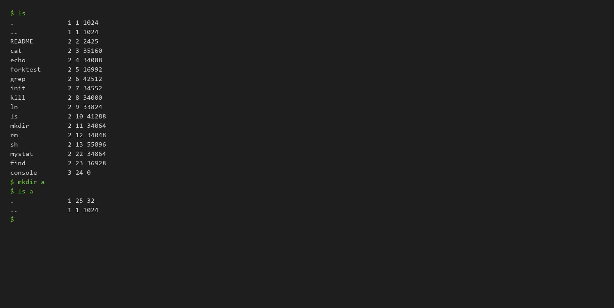
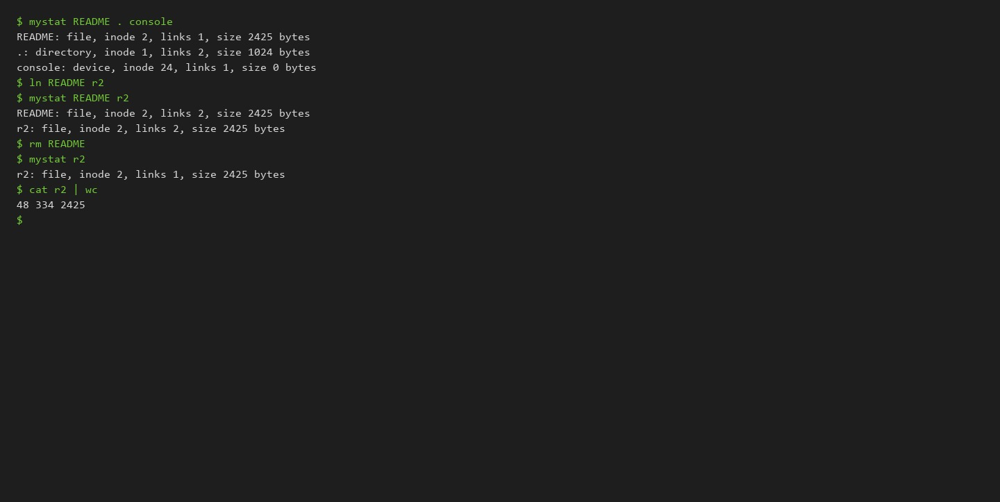
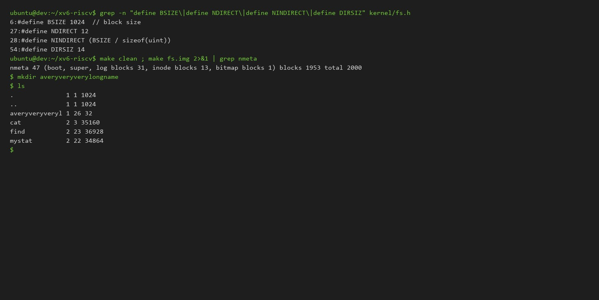
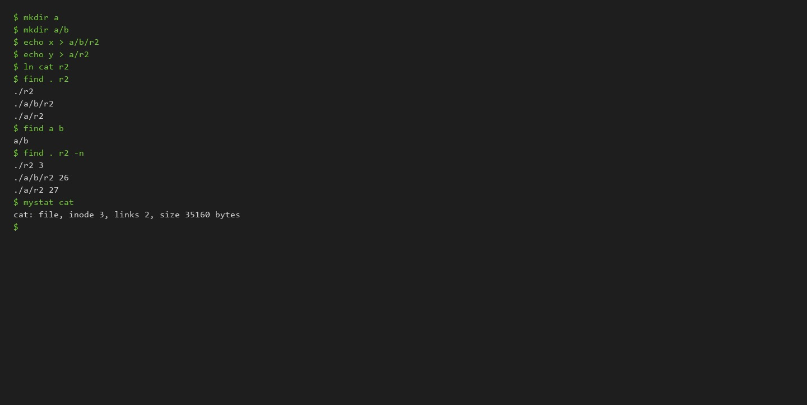

# Operating Systems Lab 6: Inside the xv6 File System

**Track:** B (Build Your Own Small OS, xv6)  
**Author:** Lucian-Adrian Gavril (FAF-241)  
**Environment:** xv6 RISC-V on QEMU 8.2.2 (emulated 3-hart virt machine)  
**Toolchain:** `riscv64-linux-gnu-gcc` 13.3.0, GNU `make` 4.3  
**Date:** 2026-10-12  

---

## Executive Summary

This laboratory analyzes the MIT xv6 filesystem implementation. The codebase provides a self-contained, crash-resilient filesystem complete with an on-disk inode layer, fixed-size directory entries, hard links, and a write-ahead journal across approximately 800 lines of C. Two utilities were authored and tested inside the QEMU environment:
1. `user/mystat.c`: Decodes filesystem inodes, object types, link counts, and byte sizes.
2. `user/find.c`: Performs recursive filesystem traversal using bounded file descriptors, complete with the optional `-n` stretch flag to emit inode identifiers alongside discovered paths.

All measurements, code snippets, QEMU console logs, and structural limits from `kernel/fs.h` are detailed below.

---

## 1. Directory Structure and Type Decoding

### Console Output

```text
$ ls
.              1 1 1024
..             1 1 1024
README         2 2 2425
cat            2 3 35160
echo           2 4 34088
forktest       2 5 16992
grep           2 6 42512
init           2 7 34552
kill           2 8 34000
ln             2 9 33824
ls             2 10 41288
mkdir          2 11 34064
rm             2 12 34048
sh             2 13 55896
stressfs       2 14 34936
usertests      2 15 184256
grind          2 16 50264
wc             2 17 36120
zombie         2 18 33416
logstress      2 19 35968
forphan        2 20 34840
dorphan        2 21 34288
mystat         2 22 34864
find           2 23 36928
console        3 24 0

$ mkdir a
$ ls a
.              1 25 32
..             1 1 1024
```



### Observation Analysis

- **Type Decoding (`kernel/stat.h`):**
  - `T_DIR` (1): Represents directory tables.
  - `T_FILE` (2): Represents regular files containing byte streams.
  - `T_DEVICE` (3): Represents major/minor character devices (e.g., console at inode 24).
- **The Root Inode (`ROOTINO = 1`):**
  The root directory `/` is stored at inode 1. In standard directory tables, `.` references the current node and `..` references the parent node. At the root of the namespace, there is no higher parent, so both `.` and `..` refer to inode 1.
- **Entry Granularity:**
  Each `struct dirent` in xv6 contains a 2-byte unsigned short inode number and a 14-byte filename string (`DIRSIZ = 14`), totaling exactly 16 bytes. An empty directory reports a byte size of 32 bytes, consisting of exactly two 16-byte records: `.` (inode 25) and `..` (inode 1).

---

## 2. Inode Inspection Utility (`mystat`)

### Implementation Details

`user/mystat.c` wraps the `stat()` system call to inspect on-disk metadata:

```c
#include "kernel/types.h"
#include "kernel/stat.h"
#include "user/user.h"

char *
typename(int t)
{
  switch(t) {
  case T_DIR:    return "directory";
  case T_FILE:   return "file";
  case T_DEVICE: return "device";
  default:       return "?";
  }
}

int
main(int argc, char *argv[])
{
  struct stat st;

  if(argc < 2){
    fprintf(2, "usage: mystat <path...>\n");
    exit(1);
  }

  for(int i = 1; i < argc; i++){
    if(stat(argv[i], &st) < 0){
      fprintf(2, "mystat: cannot stat %s\n", argv[i]);
      continue;
    }
    printf("%s: %s, inode %d, links %d, size %ld bytes\n",
           argv[i], typename(st.type), st.ino, st.nlink, st.size);
  }
  exit(0);
}
```

### Observing Hard Link Dynamics

```text
$ mystat README . console
README: file, inode 2, links 1, size 2425 bytes
.: directory, inode 1, links 2, size 1024 bytes
console: device, inode 24, links 1, size 0 bytes

$ ln README r2
$ mystat README r2
README: file, inode 2, links 2, size 2425 bytes
r2: file, inode 2, links 2, size 2425 bytes

$ rm README
$ mystat r2
r2: file, inode 2, links 1, size 2425 bytes

$ cat r2 | wc
48 334 2425
```



### Inode Lifecycle and Deallocation

In `kernel/sysfile.c`, the `sys_unlink()` system call removes the directory record and decrements the inode link count:

```c
// kernel/sysfile.c, line 230
ip->nlink--;
iupdate(ip);
```

Crucially, **`sys_unlink()` does not free disk blocks**. Physical blocks are deallocated only when `iput()` (`kernel/fs.c`, line 342) evaluates that:
$$\texttt{ip->ref} == 1 \quad \wedge \quad \texttt{ip->nlink} == 0$$
When this condition holds, `iput()` invokes `itrunc(ip)`. That function loops over all direct block numbers and the indirect block table, returning each block to the free allocation bitmap via `bfree()`. If any process maintains an open file descriptor referencing the inode (`ip->ref > 1`), deallocation is postponed until the last reference closes.

### On-Disk Inode Structure

Unlike Linux ext4, which stores timestamps, extended attributes, UIDs, GIDs, and permission modes, the xv6 on-disk inode (`struct dinode` in `kernel/fs.h`) is strictly minimalist:

```c
struct dinode {
  short type;              // File type (T_DIR, T_FILE, T_DEVICE)
  short major;             // Major device number (T_DEVICE only)
  short minor;             // Minor device number (T_DEVICE only)
  short nlink;             // Hard link counter
  uint size;               // File size in bytes
  uint addrs[NDIRECT+1];   // Block pointers: 12 direct + 1 indirect
};
```

---

## 3. Structural Limits of the Filesystem

### Constant Definitions in `kernel/fs.h`

```bash
$ grep -n "define BSIZE\|define NDIRECT\|define NINDIRECT\|define DIRSIZ" kernel/fs.h
6:#define BSIZE 1024  // block size
27:#define NDIRECT 12
28:#define NINDIRECT (BSIZE / sizeof(uint))
54:#define DIRSIZ 14
```

### Name Truncation at 14 Characters

```text
$ mkdir averyveryverylongname
$ ls
...
averyveryveryl 1 26 32
```



### Maximum File Size Derivation

- Each disk block spans $\text{BSIZE} = 1024\text{ bytes}$.
- Direct block array holds $\text{NDIRECT} = 12$ blocks.
- One indirect block holds 32-bit unsigned integer block numbers ($\text{sizeof}(\text{uint}) = 4\text{ bytes}$):
  $$\text{NINDIRECT} = \frac{\text{BSIZE}}{\text{sizeof}(\text{uint})} = \frac{1024}{4} = 256\text{ blocks}$$
- Maximum block capacity:
  $$N_{\text{max}} = \text{NDIRECT} + \text{NINDIRECT} = 12 + 256 = 268\text{ blocks}$$
- Maximum file capacity in bytes:
  $$\text{Capacity} = 268 \times 1024\text{ bytes} = 274,432\text{ bytes} \approx 268\text{ KiB}$$

### Disk Geometry and Allocation (`nmeta`)

During build time, `mkfs` prints the disk image geometry:
```text
nmeta 47 (boot, super, log blocks 31, inode blocks 13, bitmap blocks 1) blocks 1953 total 2000
```
- **Total Blocks:** 2000 blocks (2 MiB disk).
- **Metadata Blocks (47 total):**
  - Block 0: Boot block.
  - Block 1: Superblock.
  - Blocks 2–31: Write-ahead logging area (30 blocks).
  - Blocks 32–44: Inode table ($13\text{ blocks} \times 16\text{ inodes/block} = 208\text{ total inodes}$).
  - Block 45: Free block allocation bitmap (1 block).
- **Data Blocks:** 1953 blocks available for user files and directory tables.

---

## 4. Recursive Search Utility (`find`) and the `-n` Stretch

### Implementation Details

`user/find.c` implements recursive traversal across the filesystem tree. It handles string formatting, skips `.` and `..` to prevent infinite cycles, enforces safe file descriptor reclamation within xv6's 16-descriptor boundary, and includes the stretch `-n` argument to output inode numbers:

```c
#include "kernel/types.h"
#include "kernel/stat.h"
#include "user/user.h"
#include "kernel/fs.h"
#include "kernel/fcntl.h"

static int show_ino = 0;

void
find(char *path, char *target)
{
  char buf[512], *p;
  int fd;
  struct dirent de;
  struct stat st;

  if((fd = open(path, O_RDONLY)) < 0){
    fprintf(2, "find: cannot open %s\n", path);
    return;
  }

  if(fstat(fd, &st) < 0){
    fprintf(2, "find: cannot stat %s\n", path);
    close(fd);
    return;
  }

  if(st.type != T_DIR){
    close(fd);
    return;
  }

  if(strlen(path) + 1 + DIRSIZ + 1 > sizeof(buf)){
    fprintf(2, "find: path too long\n");
    close(fd);
    return;
  }

  strcpy(buf, path);
  p = buf + strlen(buf);
  *p++ = '/';

  while(read(fd, &de, sizeof(de)) == sizeof(de)){
    char name[DIRSIZ + 1];

    if(de.inum == 0)
      continue;

    memmove(name, de.name, DIRSIZ);
    name[DIRSIZ] = 0;

    if(strcmp(name, ".") == 0 || strcmp(name, "..") == 0)
      continue;

    strcpy(p, name);

    if(stat(buf, &st) < 0){
      fprintf(2, "find: cannot stat %s\n", buf);
      continue;
    }

    if(strcmp(name, target) == 0){
      if(show_ino)
        printf("%s %d\n", buf, st.ino);
      else
        printf("%s\n", buf);
    }

    if(st.type == T_DIR){
      find(buf, target);
    }
  }

  close(fd);
}

int
main(int argc, char *argv[])
{
  if(argc < 3){
    fprintf(2, "usage: find <dir> <name> [-n]\n");
    exit(1);
  }

  if(argc >= 4 && strcmp(argv[3], "-n") == 0){
    show_ino = 1;
  }

  find(argv[1], argv[2]);
  exit(0);
}
```

### Verification on a Fresh Disk Image

```text
$ mkdir a
$ mkdir a/b
$ echo x > a/b/r2
$ echo y > a/r2
$ ln cat r2

$ find . r2
./r2
./a/b/r2
./a/r2

$ find a b
a/b

$ find . r2 -n
./r2 3
./a/b/r2 26
./a/r2 27

$ mystat cat
cat: file, inode 3, links 2, size 35160 bytes
```



### Stretch Finding: Inode Identity

The `-n` option directly reveals inode relationships:
- `./r2` has inode `3`.
- `mystat cat` confirms `cat` has inode `3` and link count `2`.
- **Finding:** `./r2` and `cat` are the exact same physical file on disk, sharing inode 3 and identical blocks.
- `a/b/r2` (inode 26) and `a/r2` (inode 27) are newly created distinct files with distinct inodes.

---

## 5. Makefile Integration

The utilities were registered under `UPROGS` in `Makefile`:

```makefile
UPROGS=\
	$U/_cat\
	$U/_echo\
	$U/_forktest\
	$U/_grep\
	$U/_init\
	$U/_kill\
	$U/_ln\
	$U/_ls\
	$U/_mkdir\
	$U/_rm\
	$U/_sh\
	$U/_stressfs\
	$U/_usertests\
	$U/_grind\
	$U/_wc\
	$U/_zombie\
	$U/_logstress\
	$U/_forphan\
	$U/_dorphan\
	$U/_mystat\
	$U/_find\
```

---

## Conclusion

By implementing `mystat` and `find`, this laboratory explored xv6's filesystem architecture. The directory structure as an array of 16-byte `struct dirent` records explains name truncation at 14 characters (`DIRSIZ = 14`). Inode link counts separate directory names from physical storage blocks, deferring block reclamation to `iput()` when both `nlink == 0` and `ref == 1`. The recursive `find` tool proves that hierarchical tree resolution requires disciplined descriptor closure to operate within xv6's process limits.
