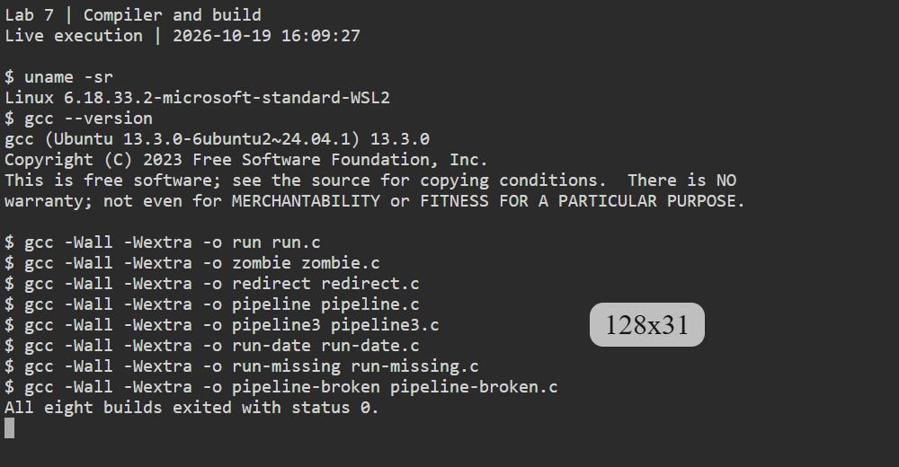
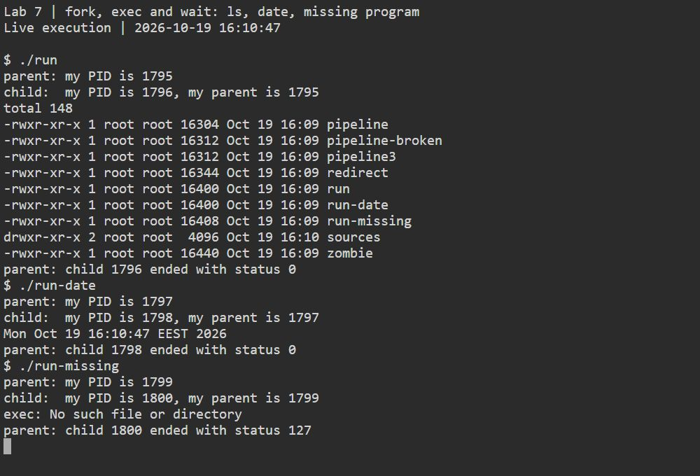
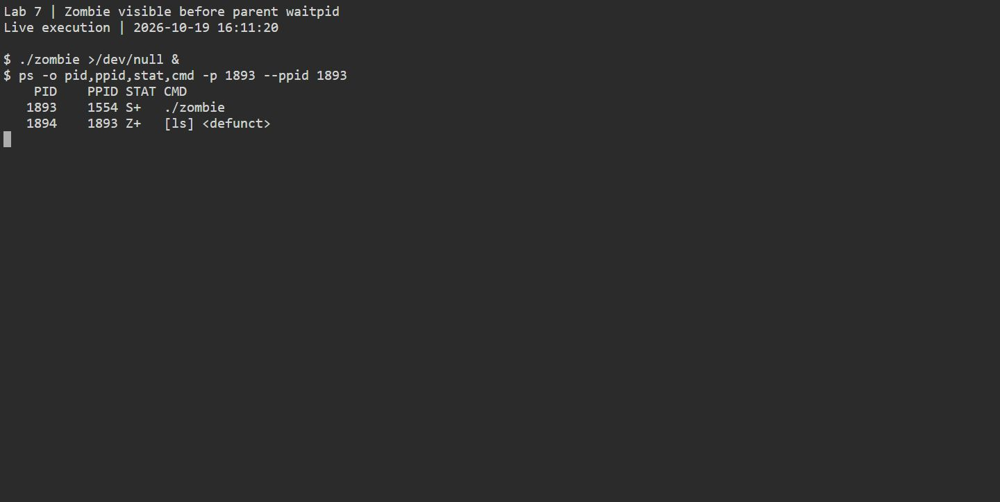
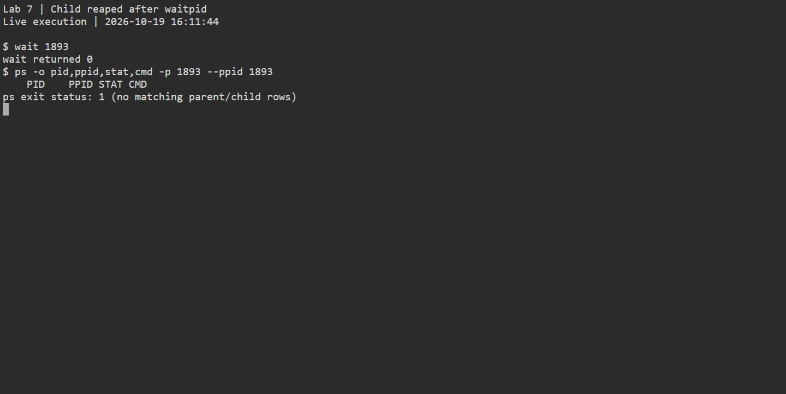
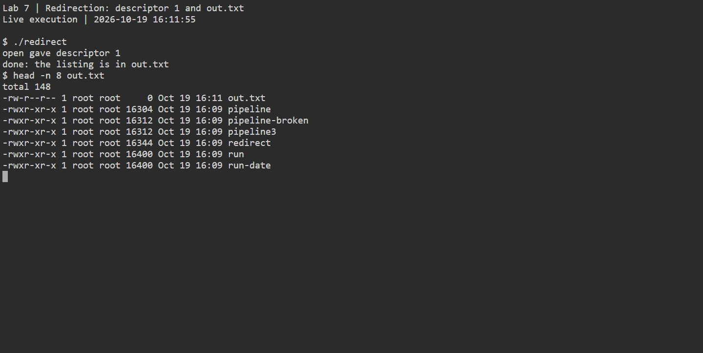
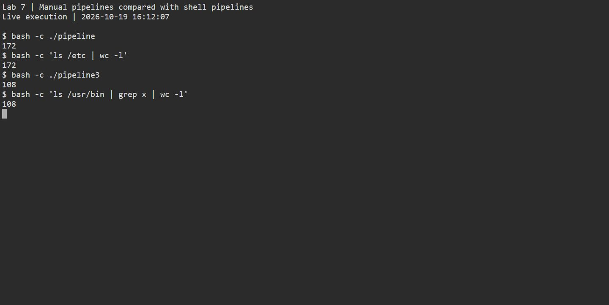
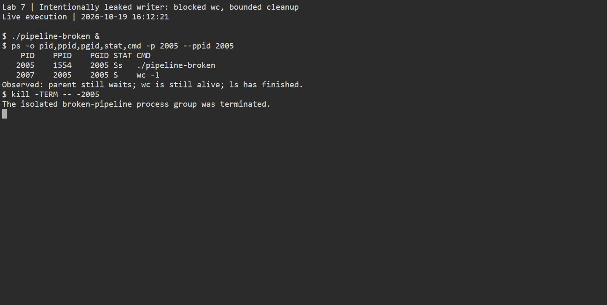
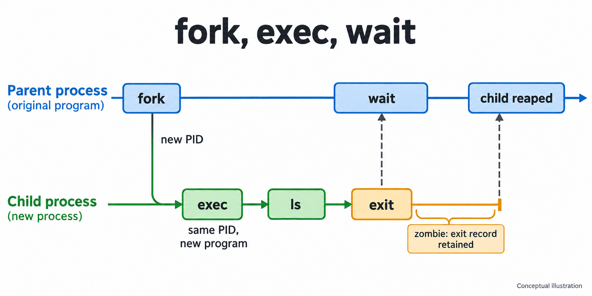
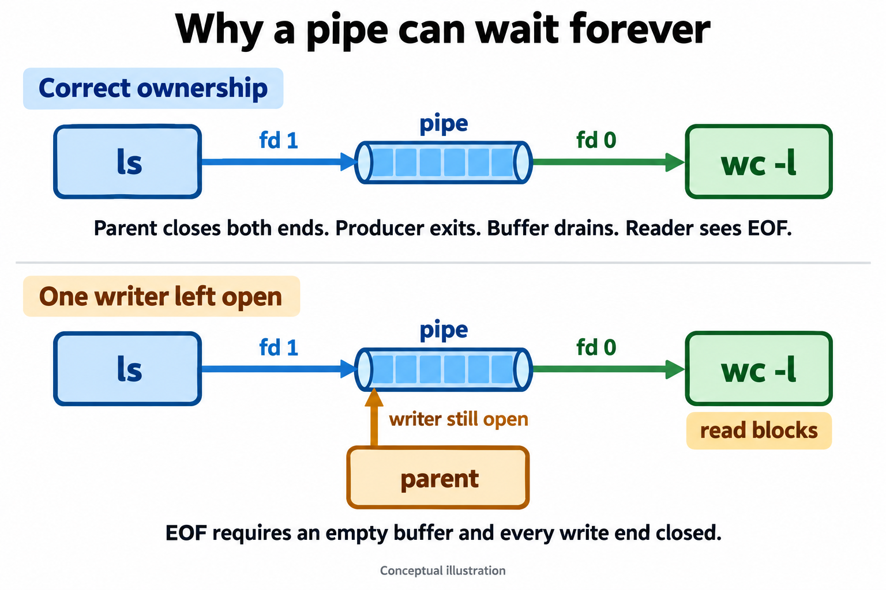

# Lab 7 report

This lab reconstructs shell command execution in C. Four programs exercise process creation and replacement, child reaping, output redirection and a two-stage pipeline. A three-stage pipeline extends the same descriptor-wiring mechanism.

**Measured environment:** Ubuntu 24.04 under WSL2, kernel `6.18.33.2-microsoft-standard-WSL2`, GCC `13.3.0`. The 19 October 2026 capture session compiled all five programs with `gcc -Wall -Wextra`. The [recorded session transcript](../lab78/execution-session-2026-10-19.txt) accompanies the original screenshots.

## Part 1: `fork`, `exec` and `wait`

### Observe 1

**Measured:** The canonical `ls` child exited with status `0`; the temporary `date` child also exited with status `0`. Neither successful execution printed the `perror("exec")` message. With `nosuchprog`, the child printed `exec: No such file or directory` and the parent reported exit status `127`.

**Explanation:** A successful `execlp` replaces the child's program image and does not return to the old code, so execution never reaches `perror`. When the requested program is missing, `execlp` returns with an error; the next line reports it, and the child exits with `127`.

### Observe 2

**Measured:** The parent printed PID `1795`; the child printed its parent PID as `1795` and its own PID as `1796`.

**Explanation:** `getppid()` returns the PID of the process that created this child. The parent stays alive in `waitpid`, so its identity has not changed before the child prints.

### Observe 3

**Measured:** The parent reported status `0` for `ls` and `127` for `nosuchprog`. The `date` variant reported status `0` as well.

**Explanation:** The `ls` program exited successfully with status `0`. The failed-`exec` branch explicitly calls `exit(127)`. `waitpid` collects that child's status for the parent.

## Part 2: a zombie

### Observe 1

**Measured:** While parent PID `1893` slept, child PID `1894` had PPID `1893` and `STAT` value `Z+`; `ps` showed `[ls] <defunct>`. The `+` is an additional process-group marker; `Z` is the zombie state asked about in the brief.

**Explanation:** `Z` means the child has exited but its parent has not yet collected its exit status. It is not still executing `ls`.

### Observe 2

**Measured:** After the 20-second sleep and `waitpid`, `ps` showed no row for parent PID `1893` or its child.

**Explanation:** The `waitpid(pid, &status, 0)` at `zombie.c:25` collects the child's remaining exit record. `sleep(20)` at line 24 only creates time to observe that record.

## Part 3: redirection

### Observe 1

**Measured:** `open` reported descriptor `1`.

**Explanation:** `close(1)` frees standard output in the child. `open` allocates the lowest available descriptor, which is now `1`.

### Observe 2

**Measured:** The directory listing was in `out.txt`; the terminal showed the open diagnostic and the parent's completion line.

**Explanation:** The child uses descriptor `2` for the diagnostic, so it remains connected to the terminal. After `open`, descriptor `1` refers to `out.txt`. `ls` writes to standard output without knowing that the destination changed.

### Observe 3

To redirect errors like `2> err.txt`, close descriptor `2` before calling `open`. Then the file receives the lowest free descriptor, `2`, which is standard error.

## Part 4: a pipe

### Observe 1

**Measured:** `./pipeline` printed `172` and the shell command `ls /etc | wc -l` printed `172` in this run.

**Explanation:** The first child sends the `ls /etc` listing through the pipe. The second reads that byte stream and counts newline characters with `wc -l`. With the same `/etc` contents, the hand-built pipeline and shell pipeline count the same lines.

### Observe 2

**Measured:** The intentionally broken variant's parent remained blocked after the bounded 0.5-second wait. The `ps` snapshot showed `wc -l` PID `2007` still running with PPID `2005`, the pipeline parent. The capture runner then sent SIGTERM to the isolated process group `2005` and waited for the pipeline parent. `ls` had finished.

**Explanation:** `wc` waits for end-of-file. The parent retained a copy of the pipe's write end, so the kernel could not report that all writers were gone even after `ls` exited.

### Observe 3

`wc` is waiting for end-of-file on its standard input. End-of-file reaches the reader only after every open reference to the pipe's write end has been closed and the buffered bytes have been consumed.

## Optional three-stage pipeline

**Measured:** `pipeline3` printed `108` and `ls /usr/bin | grep x | wc -l` printed `108` in this run.

**Explanation:** `ls` writes names to the first pipe, `grep x` reads those names and writes matching lines to the second pipe, and `wc -l` counts them. All three children and the parent close unused descriptors so each reader can receive end-of-file.

## Concept diagrams

The diagrams explain mechanisms. They are generated illustrations dated 23 October 2026; the terminal screenshots retain the actual 19 October capture.

An exited child stops executing. Its exit record remains until its parent collects it. Scheduling is schematic; the parent may enter wait before or after the child exits.

A blocked read on an empty pipe can still receive data while any writer exists. Close unused inherited copies in every process, then close the used ends when finished.

## Execution screenshots

The numbered figures in [report.pdf](report.pdf) are direct captures of the fresh Linux execution session. The original PNGs are in [assets](assets/). They show compilation, successful and failed exec, the zombie before and after reaping, redirected output, both pipeline comparisons and the deliberately blocked consumer. Earlier run logs remain separate; the PIDs and counts above correspond to these screenshots.
