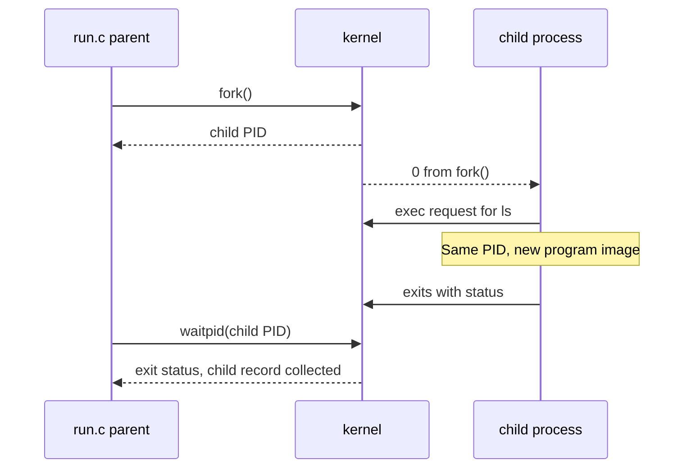
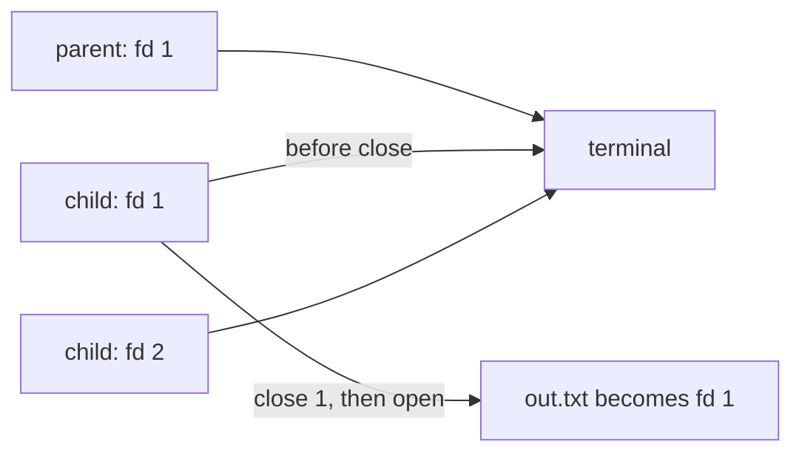
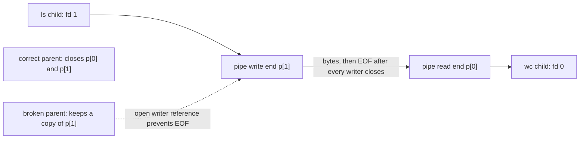

# Lab 7: how processes and file descriptors make shell commands work

This lab asks how a command starts, how its output reaches a file, and how one command can feed another. The shell is a user program that prepares each command's arguments and connections. The kernel creates processes, replaces their programs, waits for them, and moves bytes through files and pipes. The four supplied programs expose those steps one at a time.

The current [Lecture 4: Processes, Descriptors, Pipes](https://else.fcim.utm.md/mod/resource/view.php?id=72236) names the same three ideas. This lab makes their connection concrete: process calls start and collect commands; descriptor operations choose where their input and output go; a pipe carries bytes between two processes. The `printf` and `fflush` lines also show where C library buffering sits in front of the process's output descriptor.

## The user program and kernel meet at a system call

A normal program runs with limited privileges. It cannot create a kernel process entry, open an arbitrary file on its own, or move bytes through a kernel pipe by changing memory directly. It asks the kernel to perform those operations through the system-call interface. The C library gives programs convenient function names and argument formats for that interface. On Linux, `execlp` is a library routine that searches `PATH` and then requests program replacement; `printf` and `fprintf` format text in user space and send buffered bytes through a file descriptor when the stream is flushed. That is why redirection works without changing `ls`: the kernel sees `ls` writing to descriptor `1`, whose destination was set earlier.

## Start with a program and a process

A program is stored instructions. A process is one running instance of a program. It has a process ID (PID), memory and execution state, a working directory, and an open-file table. Two processes can run the same program while still having different PIDs and separate state.

On Linux, `fork` gives the child a separate process identity and virtual address space. The memory initially behaves as a copy; the implementation can share unchanged pages until a process writes to them. This lab does not depend on physical copying or shared-memory details. It depends on each side receiving its own return value from `fork` and continuing in its own process.

The usual way for a Unix shell to start an external command is a three-part sequence. The functions used here are the C/POSIX interface to kernel services: `fork`, `waitpid`, `open`, `close`, `dup` and `pipe` cross into the kernel to change process or descriptor state. By contrast, `printf`, `fprintf` and `perror` format messages in the C library; they write through descriptors rather than choosing destinations themselves.

1. `fork` asks the kernel to create a child process. The parent and child both continue at the instruction after `fork`, but `fork` returns different values in each: zero to the child, and the new child's PID to the parent. A negative value means creation failed.
2. `exec` asks the kernel to replace the calling process's program with another program. It does not create another process. If it succeeds, it does not return to the old code, and the process keeps its PID. If it fails, it returns with an error, so the following `perror` can explain why.
3. `waitpid` lets the parent wait for that particular child and collect its exit status. The kernel can then remove the child's remaining process-table entry.

In [`run.c`](run.c), lines 9–10 print the parent's PID and flush `stdout` before `fork`. Flushing matters because `fork` copies the process state, including any buffered output. If the parent line were still buffered, both processes could later flush a copy. Lines 12–20 show the split: the child branch prints its own PID and `getppid()`, then calls `execlp("ls", "ls", "-l", ...)`. `execlp` searches `PATH` for `ls`; the first `ls` is the executable name and the next string becomes `argv[0]`. Once the call succeeds, the child is running `ls` under its existing PID.

The parent receives the child's PID from `fork`, skips the child block, and waits at `run.c:24` with `waitpid(pid, &status, 0)`. This wait is about that child, not about all work on the machine. The status is encoded: `WEXITSTATUS(status)` is meaningful when `WIFEXITED(status)` is true. The teacher's sample prints it at line 25 and uses it directly because the expected `ls`, `date`, and failed-`exec` paths all exit normally.

The process identities and return values can be drawn as a short timeline:

When `execlp` cannot find `nosuchprog`, it returns instead of replacing the child. Only then does execution reach `perror("exec")` and `exit(127)`. With a successful `ls` or `date` call, the old child code disappears before `perror` can run. The parent still sees the same child's final exit code through `waitpid`.

## Why a finished child can still appear in `ps`

When a process exits, the kernel releases its running memory and resources. The parent may still need the child's exit code, so the kernel retains a small record containing the PID and termination status until the parent calls `wait` or `waitpid`. During that interval the child is a zombie, shown by `Z` in Linux's `STAT` column.

[`zombie.c`](zombie.c) adds `sleep(20)` at line 24 before the `waitpid` at line 25. Its `ls` child finishes quickly, while the parent deliberately delays collecting the result. The expected observation is a parent in a sleeping state and a short-lived `ls` child marked `Z`. After the sleep, `waitpid` collects the record and the zombie disappears. The zombie is not still executing `ls`; it is a record awaiting collection.

This is an intentionally widened timing window. In a fast real program, the zombie interval may be too brief to see with a separate `ps` command. If the parent exits without waiting, an init-like process adopts the child and eventually reaps it; the exact adopter and timing depend on the Linux environment.

## A file descriptor is a process's connection to input or output

The integers `0`, `1`, and `2` are conventional descriptors for standard input, standard output and standard error. A descriptor is an entry in one process's open-file table. It can refer to a terminal, a regular file or one end of a pipe. A program such as `ls` writes to descriptor `1`; it does not need to know whether that descriptor currently leads to a terminal or a file.

In [`redirect.c`](redirect.c), lines 11–14 close descriptor `1` and call `open`. Descriptor `1` is now the lowest unused number, so `open("out.txt", ...)` returns `1`. The `O_CREAT` flag creates the file if needed, and `O_TRUNC` empties an existing file before writing. The `0644` argument requests owner read/write and group/other read permissions, subject to the process's umask.

The child reports the descriptor at `redirect.c:15` with `fprintf(stderr, ...)`, which writes to descriptor `2`, still connected to the screen. It then replaces itself with `ls -l` at line 16. `ls` writes its listing to its ordinary standard output, descriptor `1`; because that number now refers to `out.txt`, the listing goes into the file. The parent waits and prints its completion line at lines 20–21 on its own descriptor `1`, still connected to the terminal. Redirecting errors instead would close descriptor `2` before opening `err.txt`.

The shell's `ls -l > out.txt` syntax performs the same kind of descriptor setup before `exec`. The teaching program demonstrates the mechanism directly with `close` and `open`. Other programs commonly use `dup2` to connect a selected descriptor to `1` or `2` without relying on the lowest-free-number rule.

Here the parent and child initially inherited the same terminal connection for `stdout`. Only the child's descriptor table is changed:

## A pipe connects one process's output to another's input

A pipe is a kernel-managed byte stream with a read end and a write end. `pipe(p)` puts descriptors for these ends in `p[0]` and `p[1]`. The writer sends bytes; a reader receives them in order. A reader gets end-of-file only after every open reference to the write end has been closed and all buffered bytes have been read.

[`pipeline.c`](pipeline.c) builds `ls /etc | wc -l` by hand. Lines 9–10 create the pipe; lines 12–20 wire and start `ls`; lines 22–30 wire and start `wc`; and lines 32–35 close the parent's copies before it waits:

1. The parent creates one pipe, then forks the `ls` child. That child closes descriptor `1` and duplicates `p[1]`. Since `1` is the lowest free descriptor, `dup` makes the pipe's write end become standard output. After closing the original pipe descriptors, it execs `ls /etc`.
2. The parent forks a second child for `wc`. That child closes descriptor `0` and duplicates `p[0]`, making the pipe's read end become standard input. It closes the original pipe descriptors and execs `wc -l`.
3. The parent uses neither pipe end, so it closes both before waiting for the two children.

After `exec`, `ls` writes the listing to standard output, which now feeds the pipe. `wc -l` reads that stream from standard input and counts newline characters. With ordinary non-terminal output, `ls /etc` prints one entry per line, so the pipeline count should equal `ls /etc | wc -l` in the shell, provided the directory contents do not change between the two commands.

The working pipeline has one writer and one reader. Closing the parent's spare references allows end-of-file to reach the reader after `ls` exits:

Closing unused ends is part of the data-flow logic. In the broken variant, the parent leaves its copy of `p[1]` open. After `ls` exits, the parent still owns a write reference, so the kernel cannot tell `wc` that no more bytes can arrive. `wc` waits for end-of-file. The parent waits for its children, and the demonstration remains stuck until the process group is stopped. The waiting process is `wc`; `ls` has already finished.

The optional [`pipeline3.c`](pipeline3.c) repeats the same rule with two pipes: `ls /usr/bin` writes to the first pipe, `grep x` reads the first and writes to the second, and `wc -l` reads the second. Its `main` creates both pipes at lines 9–17 and forks the three stages in order: `ls` at lines 19–41, `grep` at lines 43–71, and `wc` at lines 73–97. Each child duplicates its needed end and closes all four original pipe descriptors before `execlp`; the parent closes all four at lines 99–102 before waiting at lines 103–105. Otherwise, a stray writer could prevent the next stage from seeing end-of-file.

## Limits and useful distinctions

- A PID identifies a process, not the executable name currently inside it. A successful `exec` changes the program but preserves the process identity.
- A zombie is an exited child awaiting collection, not a process still consuming CPU. Its visible duration depends on when the parent waits and how the environment presents process state.
- Descriptor `1` is a convention, not a special output device. Closing and reopening it changes the connection without changing `ls`.
- A pipe transports bytes and reports end-of-file only when all writers are gone. It does not know which command is conceptually “finished.”
- `wc -l` counts newline bytes in its input. The current count of `/etc` entries or names containing `x` in `/usr/bin` is machine-specific and can change as files are added or removed.
- The pipeline children run concurrently. For these small listings the buffered pipe is sufficient, but for larger output a writer can block when the finite pipe buffer fills until a reader consumes data.

## Safe run sequence

Build in a temporary Linux directory and keep `out.txt` and experimental variants there. The four canonical C files must stay as supplied by the teacher. The bounded broken-pipeline command and zombie `ps` sequence are in this folder's [README](README.md).

## Report route and ten-minute reading practice

The report records the observations; this note is the explanation route through them. Start at [report.pdf, Part 1, pages 5-6](report.pdf), where `run.c` shows the fork/exec/wait sequence. Continue to Part 2, pages 8-9, for the zombie interval; Part 3, pages 10-11, for descriptor 1 and redirection; and Part 4, pages 12-14, for pipe ownership, matching counts, and the deliberately blocked reader. The references are on page 17. The source appendix follows on pages 18-23. One captured Linux session, including process IDs, counts and bounded cleanup, is in [the shared execution record](../lab78/execution-session-2026-10-19.txt).

For ten minutes, spend two minutes sketching `fork -> exec -> exit -> wait` and saying which process continues at each step. Spend two minutes tracing `run.c:12-25`; name the return value in parent and child, then explain why exec failure returns. Spend two minutes distinguishing child exit from zombie collection using the `ps` observation. Spend two minutes tracing descriptor 1 from terminal to `out.txt` while stderr stays on descriptor 2. Use the final two minutes to draw both pipe ends, predict what the extra writer does, then compare your prediction with the bounded run. Finish by answering one changed-condition prompt without looking at the answer key.

## Oral practice prompts

Try to answer each prompt aloud before opening the checking answers. The first fifteen cover likely defense questions. The last five change one condition or ask what the measurement can actually establish.

### Fifteen likely prompts

1. After fork, what does the child receive, what does the parent receive, and which branch runs?

2. Why does run.c flush stdout immediately before fork?

3. Explain program versus process using the child in run.c.

4. What does execlp search, and what does its first argument after the file name become?

5. Why is the perror line reached only when the requested program cannot be executed?

6. How should a parent establish that a child exited normally before reading its exit code?

7. Why does the missing-command version report status 127 in this lab?

8. What relationship do getpid and getppid show in the captured run, and are those numbers fixed?

9. A ps row shows state Z for the child in zombie.c. Is ls still executing?

10. Why does zombie.c sleep before waitpid, and does that guarantee every observer sees a zombie?

11. What action removes the zombie row in the captured observation?

12. What do descriptors 0, 1 and 2 conventionally mean?

13. Why does open return descriptor 1 after redirect.c closes descriptor 1?

14. Why does the open diagnostic stay on screen while the ls listing goes into out.txt?

15. What are O_CREAT, O_TRUNC and 0644 doing in redirect.c?

### Five harder, changed-condition prompts

16. If a child exits because a signal killed it, can the parent interpret the status as an ordinary exit code?

17. Does status 127 prove that the executable name was absent from PATH?

18. The parent closes its pipe writer, but wc still waits. What single leak could explain it?

19. In the measured broken run, why is wc waiting while ls has already finished?

20. Both pipeline counts were 172. What does that demonstrate, and what does it not prove?

## Checking answers

Each answer gives the rule, why it follows, a changed condition to test, and where to trace it in source and report.

1. **Answer:** The child receives 0 and takes the child branch. The parent receives the child's positive PID and continues to wait. **Why:** The return value is the same event viewed in two process contexts; it is how one source line selects two paths. **If changed:** If fork fails, it returns a negative value and neither normal child nor parent-success path should be treated as valid. **Trace:** `run.c:12-15`; report Part 1, pp. 5-6.

2. **Answer:** It prevents text still buffered in the parent's stdio stream from being copied into the child and printed twice later. **Why:** fork duplicates memory state as well as creating a process, so an unflushed user-space buffer is copied. **If changed:** If output is already unbuffered or the buffer is empty, this particular duplicate-output risk is absent. **Trace:** `run.c:9-12`; report Part 1, p. 5.

3. **Answer:** A program is executable instructions such as ls. A process is a running instance with a PID, memory, state and descriptors. The child process starts as a copy and later runs ls. **Why:** The PID belongs to the process identity, not to a filename. **If changed:** After successful exec the program changes, but the same child process and PID continue. **Trace:** `run.c:12-20`; report Part 1, pp. 5-6.

4. **Answer:** execlp searches PATH when the file name has no slash. The next argument becomes argv[0], conventionally the program name passed to the new image. **Why:** The executable lookup name and argument vector are separate inputs to exec. **If changed:** An absolute path such as /bin/ls avoids PATH search; argv[0] can still be a chosen string. **Trace:** `run.c:18`; report Part 1, p. 5.

5. **Answer:** Successful exec replaces the child image and does not return. A failed exec returns -1, so the next source line reports the error. **Why:** The return path itself distinguishes success from failure. **If changed:** If the path exists but permission or format prevents execution, exec can still fail and return. **Trace:** `run.c:18-20`; report Part 1, pp. 5-6.

6. **Answer:** It checks WIFEXITED(status) first, then uses WEXITSTATUS(status). The encoded wait status can also describe signal termination. **Why:** The integer returned through waitpid contains status information, not always a plain exit value. **If changed:** If WIFSIGNALED(status) is true, inspect WTERMSIG instead of treating WEXITSTATUS as a normal result. **Trace:** `run.c:23-25`; report Part 1, p. 6.

7. **Answer:** The source explicitly calls exit(127) after execlp fails. The number is the program's chosen error status, not a value returned by exec. **Why:** exec reports failure by returning; the child code decides how to terminate afterward. **If changed:** Changing the explicit exit value changes what the parent observes. xv6 Lab 8 uses 1 for its own failure path. **Trace:** `run.c:19-20`; report Part 1, pp. 5-6; measured run, p. 6.

8. **Answer:** They identify the child and its current parent. The captured run used parent 1795 and child 1796; those PIDs are one run's values, not constants. **Why:** The calls report runtime process identities assigned by the operating system. **If changed:** A later run will normally receive different PIDs; reason from parent-child relationships instead of memorizing numbers. **Trace:** `run.c:9-16`; report Part 1, p. 6; execution session, 19 Oct 2026.

9. **Answer:** No. The child has exited. The kernel retains its PID and exit information until the parent collects it with waitpid. **Why:** A zombie is a bookkeeping state after execution, not a runnable process consuming CPU. **If changed:** If the parent had already waited, the child row would have been reaped and no longer appear. **Trace:** `zombie.c:12-25`; report Part 2, pp. 8-9; execution session, 19 Oct 2026.

10. **Answer:** The delay widens the interval in which the child has exited while the parent has not waited. It improves the chance of observation but cannot make scheduling or a separate ps command perfectly deterministic. **Why:** The state exists only between child exit and parent collection. **If changed:** Without the delay the same state may be too brief to catch; after waitpid it is gone. **Trace:** `zombie.c:22-25`; report Part 2, pp. 8-9.

11. **Answer:** The parent calls waitpid, receives the child's termination status, and lets the kernel release the remaining process record. The later ps found no matching rows. **Why:** Process termination and parent collection are separate events. **If changed:** If the parent never waits, an init-like process may eventually adopt and reap the child after the parent exits; timing depends on the environment. **Trace:** `zombie.c:24-26`; report Part 2, pp. 8-9; execution session, 19 Oct 2026.

12. **Answer:** They are a process's standard input, standard output and standard error. Each number refers to an open file-like connection, not a specific device. **Why:** The same program can read or write without knowing whether a descriptor points to a terminal, file or pipe. **If changed:** A shell or a program can redirect any of these connections before the target program runs. **Trace:** `redirect.c:11-16`; report Part 3, pp. 10-11.

13. **Answer:** open allocates the lowest unused descriptor in that process. Since 1 was just freed, it is allocated to out.txt. **Why:** Descriptor numbers are table indices, and open chooses an available one. **If changed:** If descriptor 1 remained open, open would normally choose another free number and ls would still write to the old stdout. **Trace:** `redirect.c:11-14`; report Part 3, pp. 10-11.

14. **Answer:** The diagnostic uses stderr, descriptor 2, which remains attached to the terminal. The child replaces descriptor 1 with the file before execing ls. **Why:** stdout and stderr are separate connections even when both originally lead to the same terminal. **If changed:** Closing and replacing descriptor 2 instead would redirect diagnostics while leaving normal output on descriptor 1. **Trace:** `redirect.c:12-16`; report Part 3, pp. 10-11; execution session, 19 Oct 2026.

15. **Answer:** O_CREAT creates out.txt if absent; O_TRUNC empties an existing file; 0644 requests owner read/write and group/other read permissions, modified by the process umask. **Why:** The open flags control file creation and replacement, while the mode supplies requested permission bits. **If changed:** Without O_TRUNC, an older longer file could retain trailing bytes after a shorter new listing. **Trace:** `redirect.c:13`; report Part 3, p. 10.

16. **Answer:** No. It should first test WIFEXITED. For signal termination, test WIFSIGNALED and inspect WTERMSIG. **Why:** waitpid reports more than one termination mode in its encoded status. **If changed:** A normal exit permits WEXITSTATUS; a signal death needs the signal-specific branch. **Trace:** `run.c:23-25`; report Part 1, p. 6.

17. **Answer:** It proves only that this source's failed-exec path chose exit(127). execlp can fail for other reasons, such as permission or format errors. **Why:** The status value is assigned after the generic exec failure; it does not encode the exact errno. **If changed:** Check the perror text or errno to distinguish a missing file from another execution failure. **Trace:** `run.c:18-20`; report Part 1, p. 6.

18. **Answer:** Another process, including the ls child, still holds a copy of the write end. The reader cannot see EOF until all write references are closed and buffered bytes are consumed. **Why:** EOF depends on ownership of every writer reference, not only the parent's descriptor table. **If changed:** Close the unused duplicate in every process; closing only the parent copy is insufficient. **Trace:** `pipeline.c:12-35`; report Part 4, pp. 12-14.

19. **Answer:** The parent intentionally retained p[1], so wc received available bytes but never EOF. The parent waited for children, while wc remained alive; the isolated process group was then terminated. **Why:** A pipe reader blocks after buffered data is exhausted whenever any writer remains open. **If changed:** Close every parent and child copy of p[1], and wc can finish after ls exits and the buffer drains. **Trace:** `pipeline.c:32-35`; report Part 4, pp. 12-14; execution session, 19 Oct 2026.

20. **Answer:** The manual pipeline and shell pipeline produced the same line count for /etc in that captured environment. It does not prove a permanent count, unchanged input between runs, or correctness for all data. **Why:** The test compares two mechanisms under one directory state and one execution session. **If changed:** If /etc changes between runs, equal results are no longer guaranteed even when both implementations are correct. **Trace:** `pipeline.c:9-35`; report Part 4, pp. 12-14; execution session, 19 Oct 2026.

## Visual explanation route

Start with the [process-lifetime diagram](assets/concept-process-lifetime.png). Point to fork and explain why there are two PIDs. Point to exec and explain why the child keeps its PID. Point to the amber interval and explain why exit alone does not reap the child.

Then use the [pipe-ownership diagram](assets/concept-pipe-ownership.png). Ask what changes if the parent keeps one writer open. Predict the blocked reader before checking the captured result in the report. These are concept illustrations, not execution captures.
