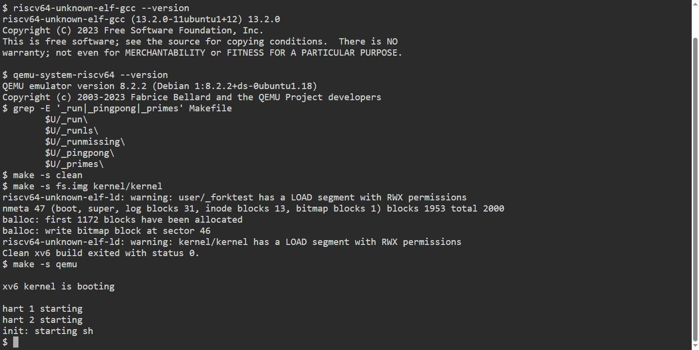
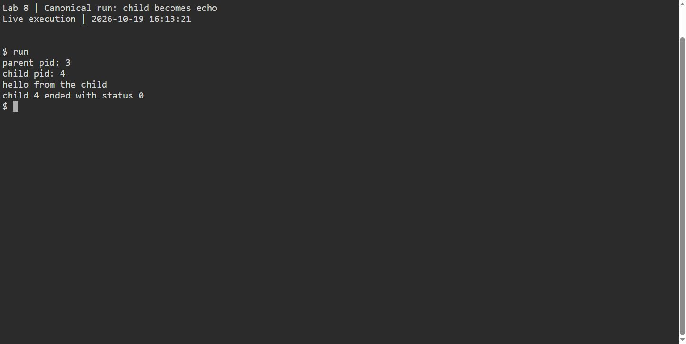
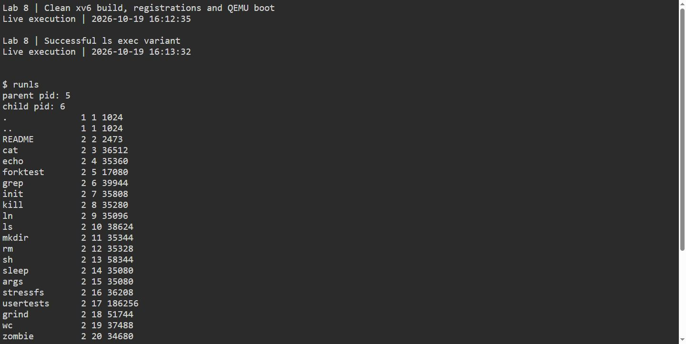
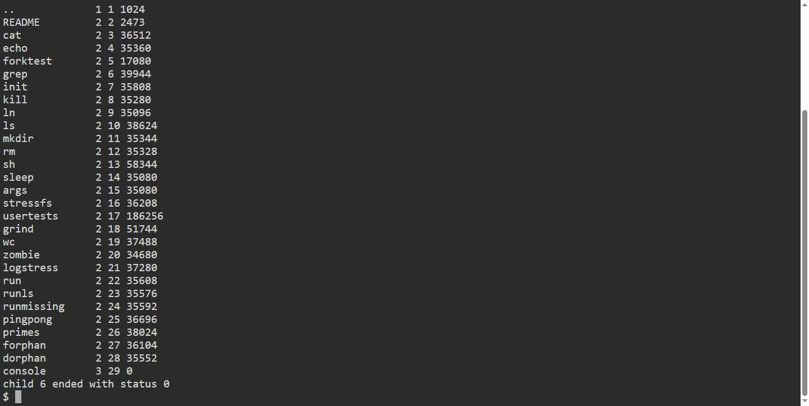
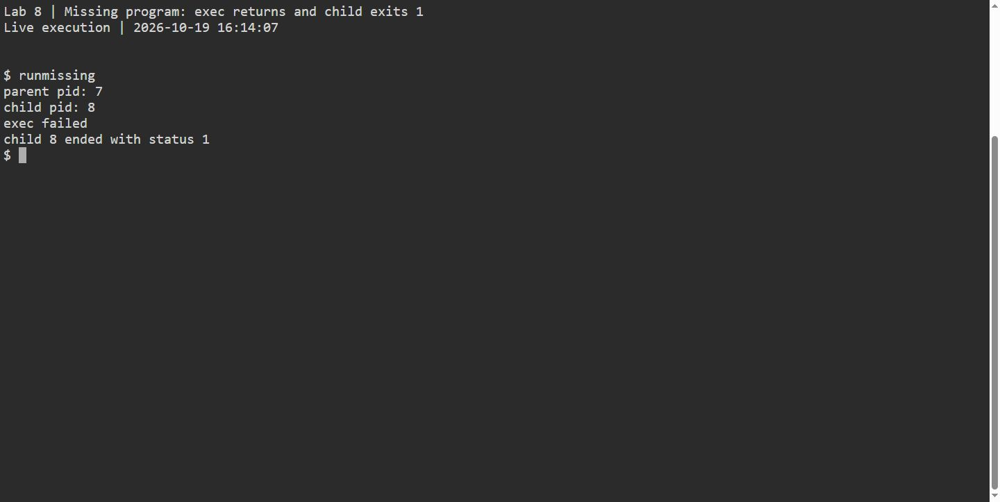
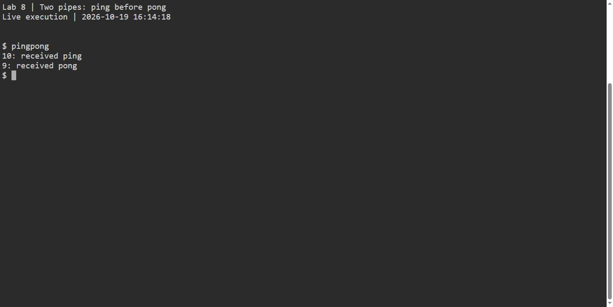
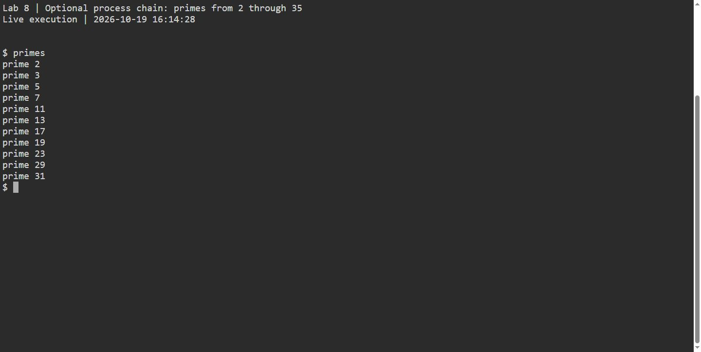

# Lab 8 observations and answers

The required `run` program demonstrates `fork`, `exec` and `wait`; [user/pingpong.c](user/pingpong.c) demonstrates a one-byte exchange over two pipes. The QEMU observations below record the behavior of these programs in xv6.

## Processes and `exec`

1. xv6 and Linux use the same basic sequence: `fork` creates a child process, `exec` replaces the child's program image, and the parent calls a wait operation to collect the child's completion. The APIs differ. xv6 provides `exec(path, argv)` and `wait(&status)`; Linux commonly uses `execlp` and `waitpid`. `execlp` searches `PATH`, while xv6 `exec` is passed a path directly. Linux's wait status is encoded and normally decoded with macros such as `WEXITSTATUS`; this xv6 implementation copies the child's integer exit value to `status`.

2. The child process prints `child pid` before the call to `exec`. If `exec` succeeds, that child becomes the `echo` program. The `echo` program prints `hello from the child`. The parent remains in `run` and prints the child's PID and status only after `wait` returns.

3. The missing-program variant prints `exec failed` and explicitly calls `exit(1)`, so xv6's `wait(&status)` reports status 1. In Lab 7's Linux `run.c`, the `execlp` failure branch instead calls `exit(127)`, and the parent decodes 127 with `WEXITSTATUS(status)`. Both values are chosen by the child program's error branch; a failed `exec` call does not itself choose an exit status. Shells also commonly use 127 for a command they cannot find.





## `exec` variants

Changing only the argument array and target tests a successful `ls` replacement and a failed `nosuchprog` replacement. The saved `user/run.c` remains the required echo example. In the missing-program case, `exec` returns an error, so the child reaches the diagnostic and `exit(1)`. For `ls`, successful `exec` never returns to `run`'s child branch.







## Two pipes

The parent writes the ping byte to `parent_to_child[1]`; the child reads it from `parent_to_child[0]`. The child writes the pong byte to `child_to_parent[1]`; the parent reads it from `child_to_parent[0]`. xv6 pipes are one-way streams, so the two directions use separate pipes. With one shared pipe, both processes would read and write through the same stream, and a reader could consume the byte it had just written.

The parent blocks in `read(child_to_parent[0], ...)` until the child writes its reply. `wait(0)` comes after the reply and collects the child's exit; it is not the call that waits for the pong byte. Each process closes the ends it does not use. That makes the ownership of each direction explicit and allows EOF to reach a reader when the remaining writers close.



## QEMU observations

The programs build cleanly with RISC-V GCC 13.2.0 and boot under QEMU 8.2.2. The original terminal screenshots below and the [recorded session transcript](../lab78/execution-session-2026-10-19.txt) preserve the captured output. The successful run uses a disposable Lab 2 overlay and the Makefile's default three CPUs.

Observed in that QEMU session:

```text
$ run
parent pid: 3
child pid: 4
hello from the child
child 4 ended with status 0

$ pingpong
10: received ping
9: received pong

$ primes
prime 2
prime 3
prime 5
prime 7
prime 11
prime 13
prime 17
prime 19
prime 23
prime 29
prime 31
```

For the successful `ls` variant, an overlay-only build printed the xv6 root-directory entries and the parent observed child status 0. For the missing-program variant, an overlay-only build printed `exec failed`, and the parent observed child status 1. Those two temporary executables were generated from `run.c` by changing only its argument array and `exec` target; the submitted source remains the echo example. Process IDs depend on the boot and are recorded here only for this run.



## Concept diagrams

The diagrams explain mechanisms. They are generated illustrations dated 23 October 2026; the terminal screenshots retain the actual 19 October capture.


An exited child stops executing. Its exit record remains until its parent collects it. Scheduling is schematic; the parent may enter wait before or after the child exits.


A blocked read on an empty pipe can still receive data while any writer exists. Close unused inherited copies in every process, then close the used ends when finished.

## Execution screenshots

The figures in [report.pdf](report.pdf) are direct browser-terminal captures of the 19 October 2026 xv6 run. The [original PNGs](assets/) show the clean build and boot, canonical echo execution, the beginning and end of the ls variant, missing-program status 1, ping before pong and all eleven primes. In this capture, pingpong uses child PID 10 and parent PID 9. The earlier run receipt remains historical.
